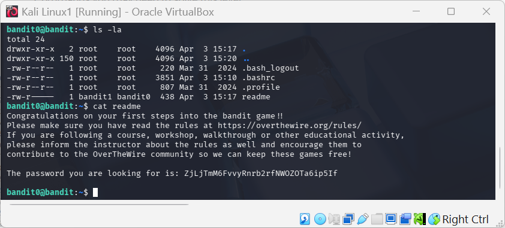

# Level 0 → Level 1

Learn how to connect to the Bandit server using SSH and navigate the basic environment.

Hello cybersecurity enthusiasts, today we will talk about fundamental Linux commands. If you are interested in learning cybersecurity, you can't jump the step of mastering Linux commands. `ls`, `cd`, `mv`, `cat`, `mkdir`, `file`, `find`, `grep`, etc. are the basics. We are going to deal with each one of them with their flags and explain it thoroughly with examples you will encounter in real life hacking. Let's talk about the first command.

> 🔗 **OverTheWire page:** [Bandit Level 0 → Level 1](https://overthewire.org/wargames/bandit/bandit1.html)

## Topics Covered

- [`ls` and `cat`](#ls-command) → list files and read a file
- [Home directory](#what-is-the-home-directory) → where we start and how to find it

## Level Goal

The password for the next level is stored in a file called `readme` located in the home directory.

## Commands You May Need

- `ls`
- `cd`
- `cat`
- `file`
- `du`
- `find`

## Important Notes

> Passwords are not saved automatically. Always keep local notes.

## Solution

### Step 1

After connecting to the Bandit server using SSH (see the [SSH page](level0.md)), the goal is to read a file called `readme` in the home directory.

As we are already in the home directory `~`, we can apply the command `ls` to check the available files.

```bash
ls
```

### Step 2

After finding the target file `readme`, let's check its content by using `cat`.

```bash
cat readme
```

See the image.



## A Bit of Theory

An amazing fact is that each action you can make with the GUI, you can achieve it with the CLI, see the [bandit overview](overview.md). Let's take some examples from what we've studied today.

### `ls` command

If you double click on a specific folder to see its content, you can do so by typing `ls` (short for list) in your terminal.

### `cat` command

If you double click on a file to read its content, the corresponding command is `cat`.

### What is the home directory?

Every user in Linux has their own personal folder called the home directory.

It's the place where Linux stores: users' personal files, settings, history and preferences.

It aims to isolate each user in the server

**The location of the home directory:**

root → /root

Other users → /home/\[other user's name\]

If you log in as **bandit0** in OverTheWire, you start in:

`/home/bandit0`

This is your “workspace.”

It starts every time you log in

In Bandit, each user has a file that contains the password for the next level **inside their home directory**.

Example:

`/home/bandit0/readme`

### How to Check Your Home Directory

- `echo $HOME` → type the value of the environment variable HOME on the terminal

Or:

- `pwd` → short for print working directory (where you are standing right now)

You will see something like:

`/home/bandit0`
