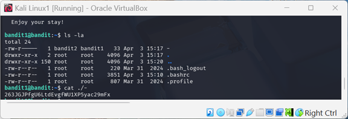

# Level 1 → Level 2

> 🔗 **OverTheWire page:** [Bandit Level 1 → Level 2](https://overthewire.org/wargames/bandit/bandit2.html)

## Topics Covered

- [Flags](#why-do-we-use-flags) → options that change how a command works
- [Dashed file names](#how-to-stop-misinterpretation-of-dashed-files-as-flags) → read a file that starts with `-`

## Level Goal

The password for the next level is stored in a file called `-` located in the home directory.

## Commands You May Need

- `ls`
- `cd`
- `cat`
- `file`
- `du`
- `find`

## Solution

### Step 1

After connecting to the Bandit server using SSH (see the [SSH page](level0.md)), the call is to read a file named `-` in the home directory.

As we are already in the home directory `~`, we can try to `cat` the file `-` directly.

Oops, an error! But why? Simply because the shell interprets the file name as if it expects a flag. *To learn more about flags, read [below](#a-bit-of-theory).*

### Step 2

How to avoid this misinterpretation? A guaranteed way is by forcing the shell to interpret it as a file by clearly setting the location `./-`, as `.` refers to the current directory followed by `/-`, the name of the file.

```bash
cat ./-
```



## A Bit of Theory

`ls` also has many flags. But wait, **what is a flag?**

A flag (*aka option or switch*) is an extra parameter you add to the command usually starts with `-` followed by a letter, or `--` followed by a word for a long descriptive flag.

### Why do we use flags?

Flags allow us to:

- Change output format

- Add extra features

- Control behavior

- Improve precision

Commands themselves are powerful but flags make them even more flexible and customizable. You can discover manual page or use `-h` or `--help` with the target command to see all available flags and how to use them. Let's take a look at some important `ls` flags:

- `ls --help` → display this help and exit

- `ls -l` → long listing including more details like permissions, owner, time, size, etc … for more understanding of the long format see `man ls`

- `ls -a` → show hidden files (which start with `.`)

- `ls -la` → both (yeah, you can bundle two flags together without a separate `-` for each one)

- `ls -lh` → human readable (usually used with `-l` and `-s`, prints sizes like 1K 234M 2G etc.)

- `-r, --reverse` → reverse order while sorting

- `-R, --recursive` → list subdirectories recursively

- `-s, --size` → print the allocated size of each file, in blocks

- `-S` → sort by file size, largest first

- `--version` → output version information and exit

### How to stop misinterpretation of dashed files as flags?

There are 3 ways of stopping misinterpretation of dashed files as flags:

1.  **Use -- to stop flag interpretation**

```bash
cat -- -file
```

`--` tells the command:

“Stop reading flags; everything after this is a filename.”

2.  **Use a path, our method**

```bash
cat ./-file
```

Why this works:

`./` makes it clear it's a file in the current directory — NOT a flag.
and that is what I personaly prefer.

3.  **Use quotes (sometimes)**

```bash
cat "-file"
```

But this doesn’t always work if the command aggressively parses flags and honstly that didn't work with me either.
