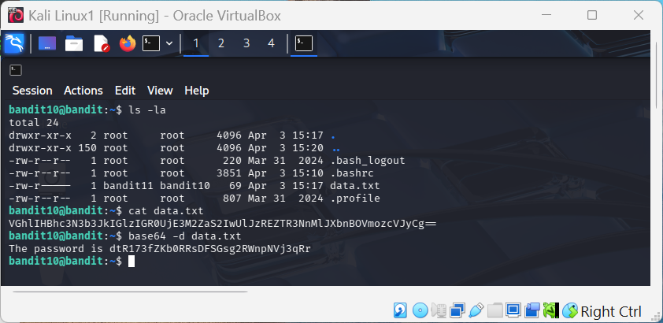

# Level 10 → Level 11

> 🔗 **OverTheWire page:** [Bandit Level 10 → Level 11](https://overthewire.org/wargames/bandit/bandit11.html)

## Topics Covered

- [Base64](#what-base64-encoded-means) → a way to write data as text
- [Encoding vs encryption](#what-is-the-difference-between-encoding-and-encryption) → they are not the same thing

## Level Goal

The password for the next level is stored in the file `data.txt`, which contains base64 encoded data.

## Commands You May Need

- `base64`

## Solution

### Step 1

After connecting to the Bandit server using SSH (see the [SSH page](level0.md)), the goal is to read the base64 file `data.txt` inside the home directory.

If we `cat data.txt`, we will have some weird sequence of characters, unreadable. That is because it is a base64 file.

### Step 2

To decode the content and read the right password, we are going to use the `base64 -d` command, a powerful tool from Linux. To learn more about it, see [below](#a-bit-of-theory).

```bash
base64 -d data.txt
```



## A Bit of Theory

### Before we start talking about base64 specifically

### What Does “Encode” Mean beforehand?

**Encoding** is the process of converting data from one format to another so it can be:

- stored safely

- transmitted reliably

- handled by systems that expect text, not binary

- displayed correctly

**Purpose:**  
👉 Encoding makes data *compatible*, *not secure*.

**Examples of encoding:**

- Base64 (binary → text)

- URL encoding (space → %20)

- UTF‑8 text encoding (<span dir="rtl">أ</span> → specific bytes)

Encoding is always **reversible** and requires **no secret key**.

### What Is Encryption?

**Encryption** transforms data into a scrambled form that **cannot be understood without the correct secret key**.

**Purpose:**  
Encryption protects data from unauthorized access.

Examples of encryption:

- AES‑256

- RSA

- TLS/HTTPS traffic

- Encrypted disks (LUKS, BitLocker)

Encryption is designed so that:

- Without the **key**, the data looks like random noise

- Only authorized parties can decrypt it

- Breaking encryption should be extremely difficult

**Example to Make It Clear**

**Original text:**

Hello

**Base64 encoded:**

SGVsbG8=

Anyone can decode this. No protection.

**AES‑Encrypted text:**

7f91b91c3e64a6e09b58b3f2...

No one can understand this without the encryption key.

### What Is the difference between Encoding and Encryption?

**Encoding makes data compatible.**

**Encryption makes data secure.**

### What “Base64 encoded” Means

**Base64 encoding** is a method of converting any kind of binary data (images, files, bytes, special characters) into a **text‑only representation** using 64 safe, printable ASCII characters:

A–Z a–z 0–9 + /

Plus the = character as padding.

Base64 is **not encryption**.  
It does **not** provide security.  
It only **translates** data into a text format.

It is a **binary‑to‑text encoding**.

### So Why Base64 Exists and why do we need it (especially in Linux)

Linux systems — especially command‑line tools, logs, configuration files, scripts, and network protocols — often expect **text‑safe data**.

But binary data:

- may contain NULL bytes (\x00)

- can break shells or scripts

- may not survive transport over protocols that expect ASCII

- can get corrupted if passed through email, JSON, YAML, or URLs

Base64 solves this by transforming binary data into plain text that will not break systems.

### How Base64 Encoding Works (Internally)

The algorithm is simple:

1.  **Take input data in chunks of 3 bytes**  
    3 bytes = 24 bits

2.  **Split 24 bits into four groups of 6 bits**  
    6-bit groups are values from 0–63 → *64 possible symbols*

3.  **Map each 6-bit group to a character** from the Base64 index table.

4.  **If the input isn’t divisible by 3 bytes**, padding (= or ==) is added.

Example:  
The ASCII word Man becomes:

- M → 01001101

- a → 01100001

- n → 01101110

Group into 6-bit chunks → map → **TWFu**

### Using Base64 in Linux Commands

Good news! Linux provides a native CLI tool called **base64**.

Yes, you don't need to do that manually anymore

**▶ Encode a file:**

```bash
base64 input.jpg > output.txt
```

**▶ Decode:**

```bash
base64 -d output.txt > restored.jpg
```

**▶ Encode a string:**

```bash
echo -n "Hello Linux" | base64
```

**▶ Decode a string:**

```bash
echo -n "SGVsbG8gTGludXg=" | base64 -d
```

### ❗Important Notes

### Base64 is not encryption

Anyone can decode it easily.

### Base64 increases size

Data grows by **33%** (roughly 4 bytes output for every 3 bytes input).

### Base64 ensures safe transmission

It guarantees that binary data won’t break across systems expecting text.

### Summary

- Base64 encodes binary data into safe, printable text.

- It is widely used in Linux for scripting, networking, APIs, certificates, and files.

- It does **not** secure the data—just transforms it.

- Linux provides a built-in base64 command for encoding/decoding.

**Encoding makes data compatible.**

**Encryption makes data secure.**
