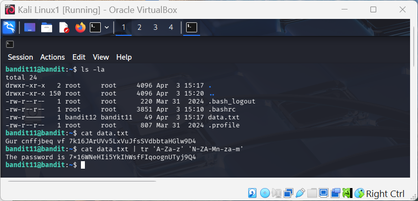

# Level 11 → Level 12

> 🔗 **OverTheWire page:** [Bandit Level 11 → Level 12](https://overthewire.org/wargames/bandit/bandit12.html)

## Topics Covered

- [ROT13 and the Caesar cipher](#what-is-the-caesar-cipher) → shift every letter by a fixed number
- [`tr` command](#the-tr-command) → replace letters with other letters

## Level Goal

The password for the next level is stored in the file `data.txt`, where all lowercase (a-z) and uppercase (A-Z) letters have been rotated by 13 positions.

## Commands You May Need

- `tr`

## Solution

### Step 1

Let's understand the challenge first. They said that the password for the next level is stored in the file `data.txt`, where all lowercase and uppercase letters have been rotated by 13 positions. That means it is encoded using a rotation of 13 letters, aka ROT13.

If we try to `cat` the file, we will see some garbage.

### Step 2

We will use the `tr` tool to decode the text and be able to understand it. We explained what encoding means, specifically base64 encoding, now we will talk more about ROT13, see [below](#a-bit-of-theory).

```bash
cat data.txt | tr 'a-zA-Z' 'n-za-mN-ZA-M'
```



## A Bit of Theory

### What Does “Rotated by 13 Positions” Mean?

### Alphabet Basics

The English alphabet has **26 letters**:

a b c d e f g h i j k l m n o p q r s t u v w x y z

If we rotate letters by **13 positions**:

- a → n

- b → o

- …

- n → a

- z → m

It **wraps around** when reaching the end.

This applies **separately** to:

- lowercase letters a–z

- uppercase letters A–Z

**Example**

Original text: ``hello``

ROT13 result: ``uryyb``

### What Is the Caesar Cipher?

### Historical Background

If you are interested in cybersecurity, absolutely you will have heard about the **Caesar Cipher**. it is one of the oldest encryption techniques. It is named after **Julius Caesar**, who used it to protect military messages during his military campaigns.

### How It Works

The Caesar Cipher:

- Shifts letters by a fixed number (N)

- This number is also called a key

- In the Caesar Cipher we use the same number(key) to encrypt and decrypt a piece of data

- This is also known as a symmetric key

- ROT13 is simply **Caesar Cipher with shift = 13**

- We can't rely on the Caesar Cipher to protect sensitive messages as the number of English letters is just 26, so we have only 25 possibilities to break into any given messages. However, it is still useful to understand the historical overview of cryptography

Examples:

- Shift 1 → a → b

- Shift 3 → a → d

- Shift 13 → a → n (ROT13)


### How Do We Decode ROT13 on Linux?

### The tr Command

tr stands for **translate**.


### tr Command Syntax

```bash
tr 'SET1' 'SET2'
```

**Meaning:** Replace every character found in ``SET1`` with the corresponding character in ``SET2``

**Important Rule:** Both sets **must be the same length**

### Using tr for ROT13

### Full Command

```bash
cat data.txt | tr 'a-zA-Z' 'n-za-mN-ZA-M'
```

### Explanation

**1. cat data.txt:** Reads the file content

**2. `|` Pipe:** sends output to another command

### 3. tr 'a-zA-Z' 'n-za-mN-ZA-M'

- Translates each letter using ROT13 rules

- Keeps punctuation and numbers unchanged
