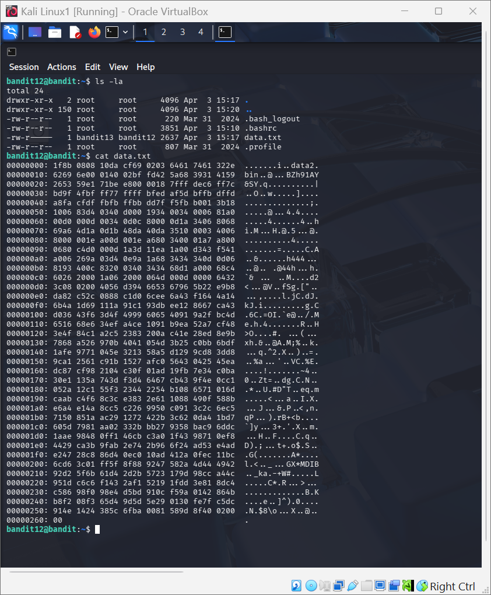
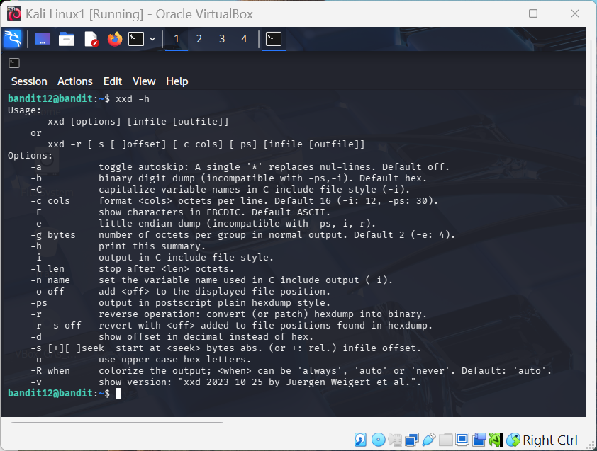
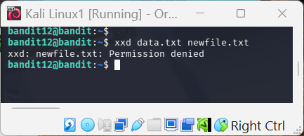
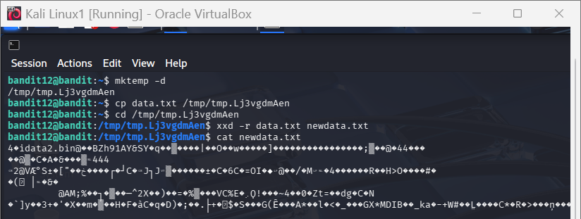
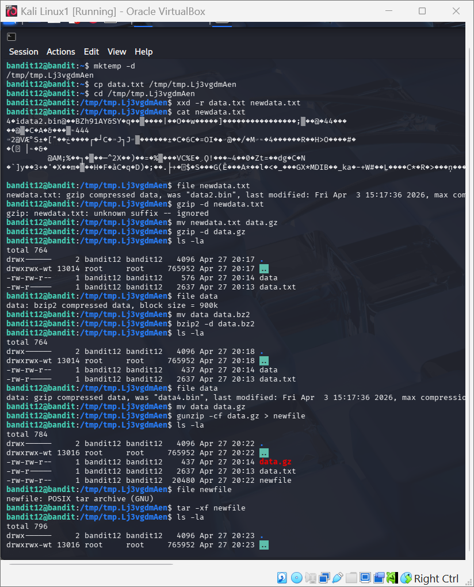

# Level 12 → Level 13

> 🔗 **OverTheWire page:** [Bandit Level 12 → Level 13](https://overthewire.org/wargames/bandit/bandit13.html)

## Topics Covered

- [Hexdump](#1-what-is-a-hexdump) → data written in hexadecimal
- [mktemp](#-what-is-mktemp) → a safe temporary place to work
- [Compression and archives](#-compress) → `gzip`, `bzip2` and `tar`

## Level Goal

The password for the next level is stored in the file `data.txt`, which is a hexdump of a file that has been repeatedly compressed.

## Commands You May Need

- `xxd`
- `gzip`
- `bzip2`
- `tar`

## Solution

It seems that there is a lot to do here. We are going to discuss the temporary directory, hexdump files, compression and archive files and useful command line tools to deal with such files. See below:

- [Hexadecimal files](#1-what-is-a-hexdump)
- [Temporary directories](#-what-is-mktemp)
- [Compression and archiving](#-compress)

### Step 1

As usual, we started by using `cat` on the file, but what we found is weird characters.



We found the type of the file using the `file` command. We found out that this is a hexadecimal file, and I tried to use the `xxd` command to decrypt it.



### Step 2

However, when we tried to store the data after using the `xxd` command, it gives us a *permission denied* error due to our current privileges as a bandit12 user.



### Step 3

At this point, the best way to bypass this obstacle is by creating a temporary file in the temp folder, which is a built-in folder in the Linux filesystem that allows us to create temporary files and directories depending on our needs, with random names to avoid any conflict, especially in a learning environment like the Bandit wargame.



### Step 4

Still, the content is very strange, and that is why we need to use the `file` command to detect the type of each file and use the right command to reflect the impact and reach the human-readable file, whether it's a compressed file or an archived one.



### Step 5

Putting all the commands together:

```bash
tmpdir=$(mktemp -d)
cp data.txt "$tmpdir"
cd "$tmpdir"
xxd -r data.txt data
file data
mv data data.gz
gzip -d data.gz
file data
mv data data.bz2
bzip2 -d data.bz2
file data
mv data data.gz
gzip -d data.gz
file data
mv data data.tar
tar xf data.tar
file data5.bin
mv data5.bin data.tar
tar xf data.tar
file data6.bin
mv data6.bin data.bz2
bzip2 -d data.bz2
file data6
cat data6
```

## A Bit of Theory

### 1. What Is a Hexdump?

### Definition

A **hexdump** is a way to **display raw binary data** in a **human‑readable format** using **hexadecimal numbers (base‑16)**.

Computers store **everything** as **bytes** (0s and 1s).  
A hexdump shows those bytes in a structured format so humans can inspect them.

### What Problems Does a Hexdump Solve?

Hexdump is used when **normal text tools fail**.

**Situations where hexdump is essential:**

| **Situation**            | **Why Hexdump Helps**    |
|--------------------------|--------------------------|
| Binary files             | cat or less show garbage |
| Non‑printable characters | Hidden control bytes     |
| File corruption          | Compare exact bytes      |
| Reverse engineering      | Inspect executables      |
| Network packets          | Analyze protocols        |
| CTF challenges           | Extract hidden data      |
| Malware analysis         | Inspect payloads         |

### What Does a Hexdump Look Like?

A typical hexdump has **3 columns**:

```text
00000000: 48 65 6c 6c 6f 20 77 6f 72 6c 64 0a Hello world
```

See below.

| **Column** | **Meaning**               |
|------------|---------------------------|
| Offset     | Byte position in file     |
| Hex bytes  | Actual byte values        |
| ASCII      | Human‑readable characters |

### What is mktemp?

mktemp is a command used in Linux/UNIX systems to **safely create a temporary file or directory**.

It ensures:

- The file/directory name is **unique**

- It won’t overwrite any existing file

- It avoids race conditions (important for security)

### Why is mktemp used?

Because manually creating a temp file like:

```bash
touch /tmp/file
```

This is dangerous, someone else might already have a file with the same name, which could lead to:Data loss, Security issues or Unexpected behavior. ``mktemp`` prevents these problems by generating a **unique** name.

### Basic Usage

### 1. Create a temporary file

```bash
mktemp
```

Example output: `/tmp/tmp.abC123xyz`

### 2. Create a temporary directory

```bash
mktemp -d
```

Example output: `/tmp/tmp.dir123abc`

### How It Works

mktemp takes a filename **template** and replaces the Xs with random characters.

Example:

```bash
mktemp myfileXXXXXX
```

Output: `myfileYhTg9A`

The **six X's** (XXXXXX) are required because that's where randomness goes.

### 🟦 Compress

To **compress** means to **make a file smaller** by removing redundancy.  
(Example: file.txt → file.txt.gz but still the *same data*, just smaller.)

### Archive

To **archive** means to **combine multiple files into one package** without necessarily shrinking them.  
(Example: many files → archive.tar.)

**In short:**

- **Compress = shrink one file**

- **Archive = bundle many files together**

### 1. GZIP

**What it is:**

gzip compresses **single files** using the gzip algorithm.  
It creates files with **.gz** extension.

**Most important flags:**

| **Flag**                  | **Meaning**                                        |
|---------------------------|----------------------------------------------------|
| gzip file                 | Compress the file (replaces original with file.gz) |
| gunzip file.gz            | Decompress (restore original file)                 |
| gzip -d file.gz           | Same as gunzip (decompress)                        |
| gzip -k file              | Keep original file after compressing               |
| gzip -c file \> output.gz | Compress and write to stdout (no overwriting)      |

**How to interact with a .gz file (short):**

- **View contents without extracting:** zcat file.gz

- **Decompress:** gunzip file.gz

### 🟦 2. BZIP2

**What it is:**

bzip2 compresses single files using the **bzip2 algorithm**, usually giving better compression than gzip but slower.

**Most important flags:**

| **Flag**                  | **Meaning**                                |
|---------------------------|--------------------------------------------|
| bzip2 file                | Compress (replaces original with file.bz2) |
| bunzip2 file.bz2          | Decompress                                 |
| bzip2 -d file.bz2         | Same as bunzip2                            |
| bzip2 -k file             | Keep original file                         |
| bzip2 -c file \> file.bz2 | Write compressed output                    |

**Interact with .bz2 file:**

- **View contents without extracting:** bzcat file.bz2

- **Decompress:** bunzip2 file.bz2

### 3. TAR
tar is **not compression** by itself. It creates **archives** (multiple files into one). Then you can compress the archive with gzip/bzip2/xz.

**Common extensions:**

- **.tar** → tar only (no compression)

- **.tar.gz** or **.tgz** → tar + gzip

- **.tar.bz2** → tar + bzip2

**Most important flags:**

| **Flag** | **Meaning**                    |
|----------|--------------------------------|
| -c       | Create archive                 |
| -x       | Extract archive                |
| -t       | List contents                  |
| -f       | Specify filename               |
| -z       | Use gzip                       |
| -j       | Use bzip2                      |
| -v       | Verbose (show processed files) |

