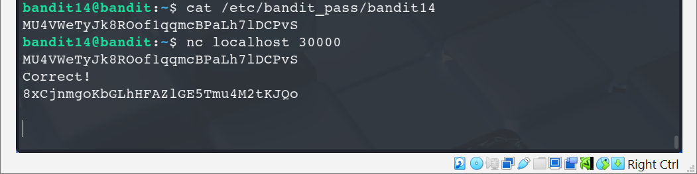

# Level 14 → Level 15

Submit the current password to port 30000 on localhost.

> 🔗 **OverTheWire page:** [Bandit Level 14 → Level 15](https://overthewire.org/wargames/bandit/bandit15.html)

## Topics Covered

- [Ports](#-what-is-the-port-30000-and-what-is-its-role) → what a port is and its role
- [Netcat (`nc`)](#-what-is-nc-netcat) → talk to a port from the terminal

## Level Goal

The password for the next level can be retrieved by submitting the password of the current level to **port 30000 on localhost**.

## Commands You May Need

- [ssh](https://manpages.ubuntu.com/manpages/noble/man1/ssh.1.html)
- `telnet`
- `nc`
- `openssl`
- `s_client`
- `nmap`

## Helpful Reading Material

- [How the Internet works in 5 minutes (YouTube) (Not completely accurate, but good enough for beginners)](https://www.youtube.com/watch?v=7_LPdttKXPc)
- [IP Addresses](https://computer.howstuffworks.com/web-server5.htm)
- [IP Address on Wikipedia](https://en.wikipedia.org/wiki/IP_address)
- [Localhost on Wikipedia](https://en.wikipedia.org/wiki/Localhost)
- [Ports](https://computer.howstuffworks.com/web-server8.htm)
- [Port (computer networking) on Wikipedia](https://en.wikipedia.org/wiki/Port_(computer_networking))

## Solution

### Step 1

It would be strange, but as you reach this level, that means you passed the private key challenge and now you are logged in as bandit14. The happy news is that you can now read the bandit14 password from the file as you already have the permissions, don't you?

```bash
cat /etc/bandit_pass/bandit14
```

### Step 2

Now, let's see what it means at first and how to send the password to port 30000.

**What does "submit the password" mean?**

When Bandit says:

**"Submit the password of the current level to port 30000 on localhost."**

It means:

**👉 You must send (type or echo) the current password**

**👉 to a small program running on port 30000**

**👉 on the same machine you are logged into (localhost)**

Think of it like sending a message to another program:

- The password = the message
- Port 30000 = where the program is listening
- The response = next level's password

### Step 3

The solution is to do that using the `nc` command, which will open a connection to a port waiting for us, depending on how it is already configured.

```bash
nc localhost 30000
```



See more in the theory below.

## A Bit of Theory

### 🟦 What is the port 30000 and what is its role?

Think of a computer like a big building.

- The **IP address** (like localhost) is the building.

- The **ports** (like 30000) are the rooms inside the building.

- Some rooms have programs waiting to talk to you.

So when Bandit says:

**Submit the password to port 30000**

It means:

**On the machine you are logged into (bandit14 server),**

- there is a program listening on port **30000**

- It's waiting for you to send it **your current password**.

- This program checks if the password is correct.

- If yes, it sends you the **next level password**.

So **port 30000 = a special service that gives you the next password if you talk to it correctly**.

### 🟩 What is nc (Netcat)?

nc is short for **Netcat**, aka the “Swiss‑army knife of networking”.

It can:

- Open a connection to a port

- Send text/data

- Receive text/data

- Create simple chat servers

- Transfer files

- Debug network services

- Test ports

- Listen for connections

But in Bandit, you use it for one basic thing:

**Connect to a program on a port and talk to it.**

### 🟧 How does nc actually work? (Deeper explanation)

When you run:

```bash
nc localhost 30000
```

Here’s what happens internally:

1.  **nc creates a TCP connection**  
    It says “Hello, port 30000, can I connect?”  
    If the port is open and a program is listening → connection accepted.

2.  **nc attaches your keyboard to that connection**  
    Anything you type is sent over the connection.

3.  **nc attaches your screen to the connection**  
    Anything the remote program sends back is printed on your terminal.

So effectively:

**nc = a direct pipe between *you* and *the program on port 30000***

That’s why when you type the password, the program checks it and sends back the next password.
