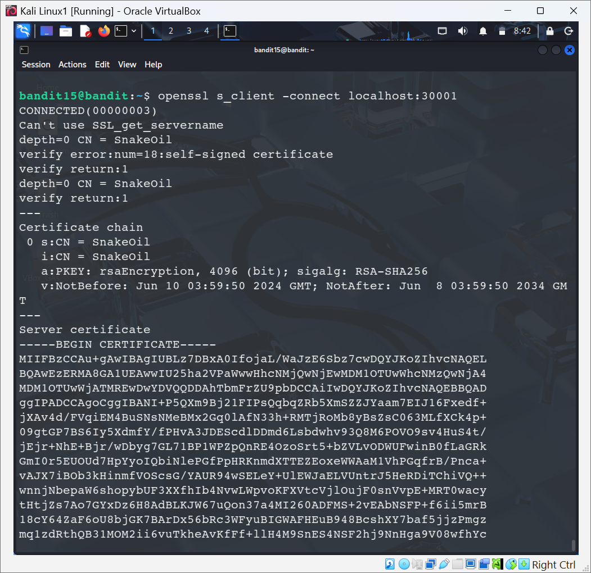
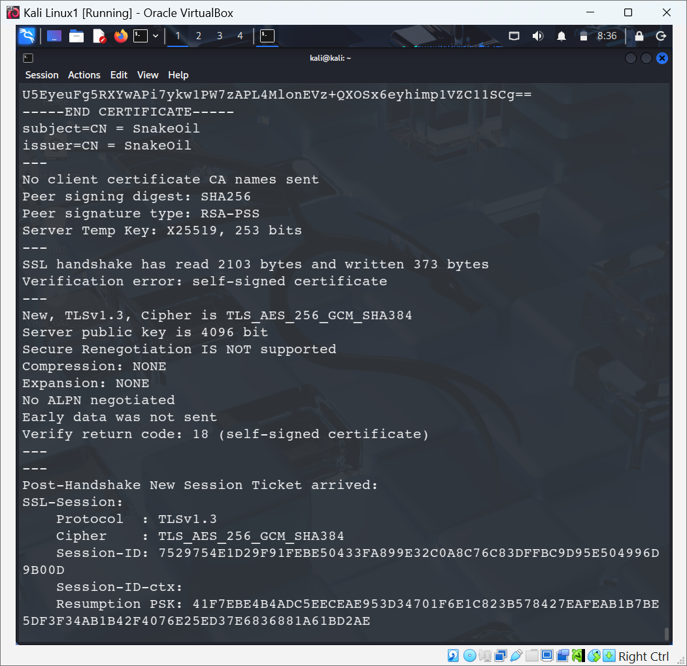
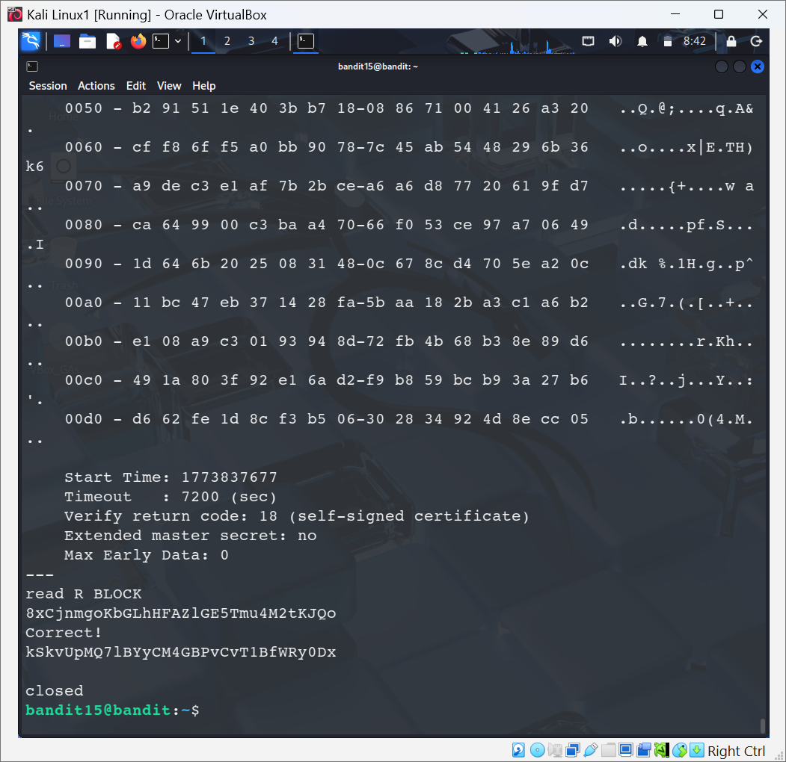

# Level 15 → Level 16

Submit the password to port 30001 using SSL/TLS encryption.

> 🔗 **OverTheWire page:** [Bandit Level 15 → Level 16](https://overthewire.org/wargames/bandit/bandit16.html)

## Topics Covered

- [SSL/TLS](#2-what-is-ssltls) → encrypted connections
- [openssl s_client](#1-what-does-using-ssltls-mean-in-this-level) → connect to a port with encryption

## Level Goal

The password for the next level can be retrieved by submitting the password of the current level to **port 30001 on localhost** using SSL/TLS encryption.

## Commands You May Need

- [ssh](https://manpages.ubuntu.com/manpages/noble/man1/ssh.1.html)
- `telnet`
- `nc`
- `ncat`
- `socat`
- `openssl`
- `s_client`
- `nmap`
- `netstat`
- `ss`

## Important Notes

> **Helpful note: Getting "DONE", "RENEGOTIATING" or "KEYUPDATE"? Read the "CONNECTED COMMANDS" section in the manpage.**

## Helpful Reading Material

- [Secure Socket Layer/Transport Layer Security on Wikipedia](https://en.wikipedia.org/wiki/Transport_Layer_Security)
- [OpenSSL Cookbook - Testing with OpenSSL](https://www.feistyduck.com/library/openssl-cookbook/online/testing-with-openssl/index.html)

## Solution

### Step 1

The goal of this level is to open a secure connection to a listening port as we did in the previous challenge, but this time we should ensure secure connectivity over SSL/TLS.

```bash
openssl s_client -connect localhost:30001
```





### Step 2

After that, we should send the password for bandit15 (this level) over this open session and wait for the password of level 16.



Let's dive deep into the new concepts: secure connection SSL/TLS, and the renegotiating that you may face during this challenge.

## A Bit of Theory

### 1. What does “using SSL/TLS” mean in this level?

```bash
openssl s_client -connect localhost:30001
```

This means: **The service on port 30001 does NOT accept normal unencrypted text It only accepts communication over an encrypted tunnel**

So instead of using normal nc, you must use a command that speaks SSL/TLS.


### 2. What is SSL/TLS?

SSL (Secure Sockets Layer) and TLS (Transport Layer Security) are security protocols that:

- **Encrypt data** between two computers

- **Authenticate** the server (and sometimes the client)

- **Protect against spying, tampering, or impersonation**

> ***Note:*** TLS is the modern version, SSL is older.

Whenever you see: 🔒 HTTPS websites, Secure email, VPN tunnels, Encrypted chat, Encrypted APIs. That’s **TLS** running underneath.

### 3. Why encryption? What problem does it solve?

Without SSL/TLS: anyone on the network can **read your data**, **modify it** and **pretend to be the server**

In cybersecurity we called that:

- eavesdropping (sniffing)

- tampering (man-in-the-middle attack)

- spoofing (fake servers)

SSL/TLS solves all of these by:

1.  **Encrypting your data**

Even if a hacker grabs the packets, they only see garbage.

2.  **Authenticating the server**

You only connect to the real server, not an impostor.

3.  **Maintaining data integrity**

The data cannot be modified without detection.

### 4. How SSL/TLS actually works

When you run:

```bash
openssl s_client -connect localhost:30001
```

Here’s what happens under the hood:

**Step 1: TLS Handshake**

Your machine and the server:

1.  Agree on a protocol version (TLS 1.2, 1.3, etc.)

2.  Decide on encryption algorithms (AES, ChaCha20…)

3.  Exchange public keys

4.  Verify certificates

5.  Create a shared session key

All of this happens **before you even type anything**.

### Step 2: Encrypted Tunnel Created

Both sides now have:

- A shared secret key

- The encryption method

- Verification that the connection is safe

Everything that happens now is encrypted.

### Step 3: You send the password (securely)

The text you type:
\<your_password\> Is encrypted, sent to the server, decrypted there, and processed.

### Step 4: Server sends back encrypted response

If the password is correct, it returns the next level password — still encrypted.

Only your machine can decrypt it.
