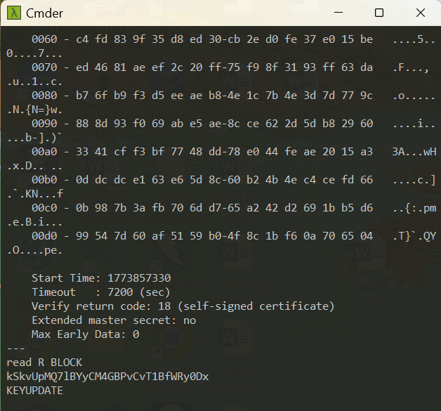
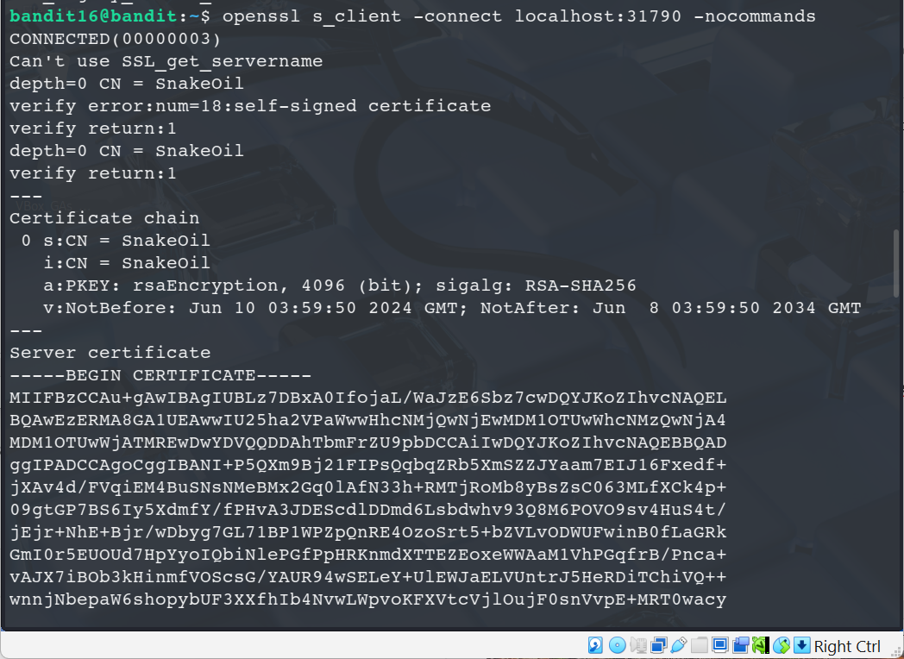

# Level 16 → Level 17

Scan ports 31000-32000 to find the SSL server that returns credentials.

> 🔗 **OverTheWire page:** [Bandit Level 16 → Level 17](https://overthewire.org/wargames/bandit/bandit17.html)

## Topics Covered

- [Nmap](#now-what-is-nmap-deep-explanation) → scan ports to find open services
- [KeyUpdate message](#1-what-keyupdate-means) → and how to avoid it with `-nocommands`

## Level Goal

The credentials for the next level can be retrieved by submitting the password of the current level to **a port on localhost in the range 31000 to 32000**. First find out which of these ports have a server listening on them. Then find out which of those speak SSL/TLS and which don't. There is only 1 server that will give the next credentials, the others will simply send back to you whatever you send to it.

## Commands You May Need

- [`ssh`](https://manpages.ubuntu.com/manpages/noble/man1/ssh.1.html)
- `telnet`
- `nc`
- `ncat`
- `socat`
- `openssl`
- `s_client`
- `nmap`
- `netstat`
- `ss`

## Important Notes

> **Helpful note: Getting "DONE", "RENEGOTIATING" or "KEYUPDATE"? Read the "CONNECTED COMMANDS" section in the manpage.**

## Helpful Reading Material

- [Port scanner on Wikipedia](https://en.wikipedia.org/wiki/Port_scanner)

## Solution

### Step 1

The challenge says:

**Find which port between 31000 and 32000 has a server listening on it.**

The easiest way to do this is with **Nmap**. Run this command:

```bash
nmap -p31000-32000 localhost
```

Look at the screenshot.


### Step 2

As you see from the Nmap result, there are 5 ports open on the server. Let's check which one is the port that provides the secure session, so it's the right port to send and receive the data we targeted. Let's go through them one by one.


### Step 3

I have already tried them one by one. The only port that seems to have the secure connection is 31790. However, when we tried to connect to it, send the password and wait for the credentials, it gives us a KEYUPDATE message!



To know more about the KeyUpdate message and how to overcome all possible errors, see the [bit of theory below](#A-Bit-of-Theory).

### Step 4

For this challenge, we overcome it by typing `-nocommands` as an option at the end of the command to avoid the misinterpretation, and it will accept the password normally and send us back the credentials.

```bash
openssl s_client -connect localhost:31790 -nocommands
```



## A Bit of Theory

### Now, what is Nmap? (Deep explanation)

Nmap = **N**etwork **Map**per  
It is one of the most powerful tools in cybersecurity.

### 1. Nmap scans ports

Nmap can check whether ports are:

- **open** → a program is listening

- **closed** → nothing is listening

- **filtered** → blocked by firewall

### 2. Nmap discovers services

Nmap can tell us: what **application** is running, what is its **version** and what **protocol** it uses

Example output:

```
80/tcp open http

443/tcp open https

22/tcp open ssh
```

### 3. Nmap can detect operating systems

Using special packet signatures, Nmap can guess the running OS even the exact distripution.

### 4. Nmap can scan networks, not just localhost

like other devices, subnets and entire networks

Example:

```bash
nmap 192.168.1.0/24
```

It will list all active devices.

### 5. Nmap uses different scanning techniques

Nmap has multiple scan types:

- SYN scan (stealth scan) → default

- Connect scan

- UDP scan

- Version detection scan

- Firewall evasion

```bash
openssl s_client -connect localhost:<ssl_port>
```

- ✔ Paste password → get next password

### 1. What “KeyUpdate” Means

**KeyUpdate** is a **TLS 1.3 feature**.  
It allows either side of a TLS connection (client or server) to **refresh encryption keys during a live session**, *without renegotiating a whole handshake*.

From the OpenSSL documentation and StackOverflow explanation I found:

- A TLS 1.3 KeyUpdate “updates the sending cryptographic keys and optionally asks the peer to update theirs.” [\[docs.openssl.org\]](https://docs.openssl.org/3.2/man3/SSL_key_update/)

- OpenSSL’s s_client triggers a KeyUpdate when the input line **begins with K or k**, but **ONLY if TLS 1.3 is in use**. [\[stackoverflow.com\]](https://stackoverflow.com/questions/58547963/openssl-keyupdate-and-ssl-key-updatewrong-ssl-version)

### 2. Why Does Typing a Password Trigger KeyUpdate?

This is the part that confuses a lot of Bandit players like me.

In openssl s_client **interactive mode**, once the TLS connection is established, certain **single-character commands** control the client. They are *not sent to the server*.

OpenSSL defines k and K as:

- **k / K → Send a TLS 1.3 KeyUpdate message**  
  (instead of sending the text we typed) [\[stackoverflow.com\]](https://stackoverflow.com/questions/58547963/openssl-keyupdate-and-ssl-key-updatewrong-ssl-version)

Even if you type a whole password (e.g. kSkvUpMQ7l...),

**OpenSSL looks ONLY at the first character.**

If that first character is:

- k → KeyUpdate

- R → renegotiation

- Q → quit

- …and so on.

So our password *is* being typed correctly, the **first character** is simply being misinterpreted as an OpenSSL command.

We can stop such feature by using `-quiet` or `-nocommands`

### 3. What ``-quiet`` and ``nocommands` Do

``-quiet``: Disables interactive command letters (like k, R, Q), and turns on `-ign_eof` and `-nocommands` so our input is treated as **raw data**

`-nocommands`: It also disables ALL interactive one-letter commands directly
