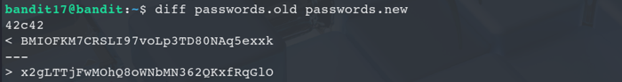

# Level 17 → Level 18

Compare `passwords.old` and `passwords.new` and find the changed line.

> 🔗 **OverTheWire page:** [Bandit Level 17 → Level 18](https://overthewire.org/wargames/bandit/bandit18.html)

## Topics Covered

- [`diff`](#a-bit-of-theory) → compare two files line by line

## Level Goal

There are 2 files in the home directory: **passwords.old and passwords.new**. The password for the next level is in **passwords.new** and is the only line that has been changed between **passwords.old and passwords.new**.

## Commands You May Need

- [cat](https://manpages.ubuntu.com/manpages/noble/man1/cat.1.html)
- [grep](https://manpages.ubuntu.com/manpages/noble/man1/grep.1.html)
- [ls](https://manpages.ubuntu.com/manpages/noble/man1/ls.1.html)
- `diff`

## Important Notes

> **NOTE: if you have solved this level and see 'Byebye!' when trying to log into bandit18, this is related to the next level, bandit19**

## Solution

### Step 1

If we `cat` the files, we can't detect the difference by ourselves, as we run into a huge amount of text. For this level, we use **diff** to compare the changes between **passwords.old and passwords.new**.

```bash
diff passwords.old passwords.new
```



To gain more insights about the `diff` tool, see [below](#a-bit-of-theory).

## A Bit of Theory

One of the most useful commands you'll learn is **diff**.

The name **diff** stands for **difference**. Its job is simple:

Compare two files and show what is different between them

- diff compares two files line by line.

- It is used to find additions, deletions, and modifications.

**Common symbols:**

\<  = first file

\>  = second file

c  = changed

a  = added

d  = deleted

**Most common usage:**

```bash
diff file1 file2
```

### Bandit Challenge Example

Suppose:

**passwords.old**

abc123

test456

pass789

### Passwords.new

abc123

newPassword

pass789

Run:

```bash
diff passwords.old passwords.new
```

Output:

2c2

\< test456

---

\> newPassword

The password is:

newPassword

because it comes from:

passwords.new

And is shown with the \> symbol.
