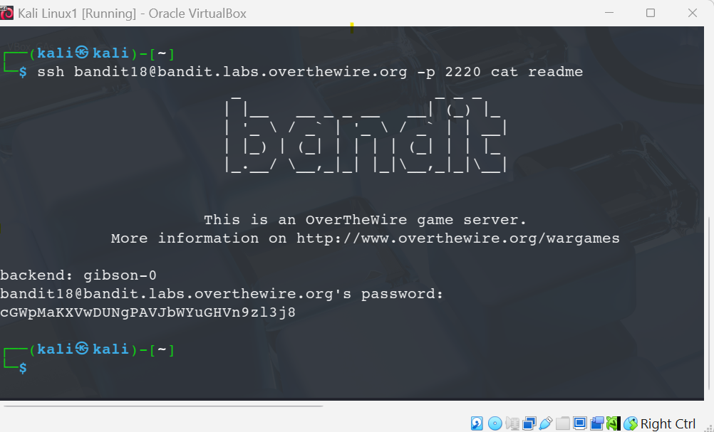

# Level 18 → Level 19

Read `readme` while `.bashrc` forces a logout.

> 🔗 **OverTheWire page:** [Bandit Level 18 → Level 19](https://overthewire.org/wargames/bandit/bandit19.html)

## Topics Covered

- [Running a command through `ssh`](#what-should-you-do) → get around a `.bashrc` that logs us out

## Level Goal

The password for the next level is stored in a file **readme** in the home directory. Unfortunately, someone has modified **.bashrc** to log you out when you log in with SSH.

## Commands You May Need

- [ssh](https://manpages.ubuntu.com/manpages/noble/man1/ssh.1.html)
- [ls](https://manpages.ubuntu.com/manpages/noble/man1/ls.1.html)
- [cat](https://manpages.ubuntu.com/manpages/noble/man1/cat.1.html)

## Important Notes

> Hint: use SSH options.

## Solution

### Step 1

For this level, if we try to log in as the user bandit18, we will be directly logged out due to some changes in the `.bashrc` file. This file always runs when we log in to a Linux machine.

### Step 2

In this level, we will try to bypass this logout by typing a command within the `ssh` command. This will open a temporary session that allows us to execute one command, see below:

```bash
ssh bandit18@bandit.labs.overthewire.org -p 2220 cat readme
```



## A Bit of Theory

.bashrc is a script that runs **every time** you open a shell session (like when you log in with SSH).  
In this bandit level, someone modified it so that as soon as you log in, the script forces a logout.  
So you never get a chance to type commands.

This is intentional for the challenge.

### What should you do?

You must avoid getting an **interactive shell**.

SSH allows you to run **a single command directly**, without launching an interactive terminal.  
This bypasses .bashrc.

**The solution:**

Instead of logging in normally, run:

```bash
ssh bandit18@bandit.labs.overthewire.org -p 2220 cat readme
```

This tells SSH:

“Connect as bandit18, but instead of giving me a shell, just run cat readme.”

Since .bashrc only triggers **when an interactive shell starts**, it **won’t run**.

**The output will be the password for bandit19.**

### Why this works

- .bashrc only runs for **interactive shells**.

- Running SSH with a command (ssh user@host command) skips the interactive shell.

- Therefore .bashrc never executes → you stay logged in long enough to run the command.
