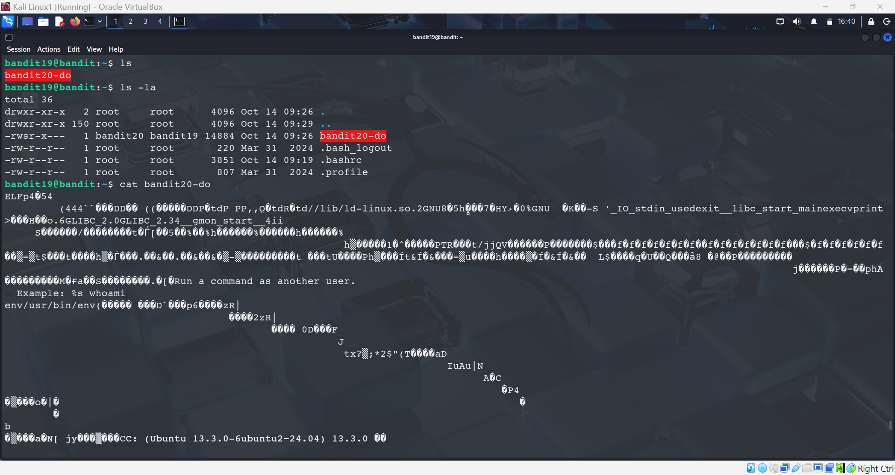
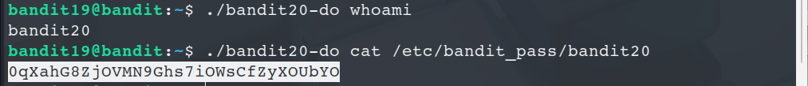

# Level 19 → Level 20

Use the provided setuid binary to access `/etc/bandit_pass`.

> 🔗 **OverTheWire page:** [Bandit Level 19 → Level 20](https://overthewire.org/wargames/bandit/bandit20.html)

## Topics Covered

- [setuid and setgid](#what-do-setuid-and-setgid-actually-mean-and-how-to-set-them) → run a program as its owner

## Level Goal

To gain access to the next level, you should use the `setuid` binary in the home directory. Execute it without arguments to find out how to use it. The password for this level can be found in the usual place (`/etc/bandit_pass`), after you have used the `setuid` binary.

## Helpful Reading Material

- [setuid on Wikipedia](https://en.wikipedia.org/wiki/Setuid)

## Solution

### Step 1

When we tried `ls -la`, we got into this file `bandit20-do` with the permissions `rwsr-xr-x`.



The `s` in the user permissions means `setuid`, and it means to run this executable file under the **owner**'s permissions. This file is a binary file that allows us to execute commands with elevated privileges.

### Step 2

We will benefit from that by using `cat` on the file that contains the password of `bandit20`.

```bash
./bandit20-do cat /etc/bandit_pass/bandit20
```



## A Bit of Theory

### What do setuid and setgid actually mean and how to set them?

### Set setuid (user ID bit)

This makes the program run as **the file’s owner**.

```bash
chmod u+s filename
```

Permissions will show:
`-rwsr-xr-x`

The **`s`** in the user field means `setuid` is ON.

### Set setgid (group ID bit)

This makes the program run as **the file’s group**.

```bash
chmod g+s filename
```

Permissions will show:
`-rwxr-sr-x`

The **`s`** in the group field means `setgid` is ON.

### How to use (benefit from) setuid/setgid

When we run a file that has:

**`setuid` → you temporarily “become” the file owner**

**`setgid` → you temporarily “become” the file’s group**

- And therefore read the next password!

