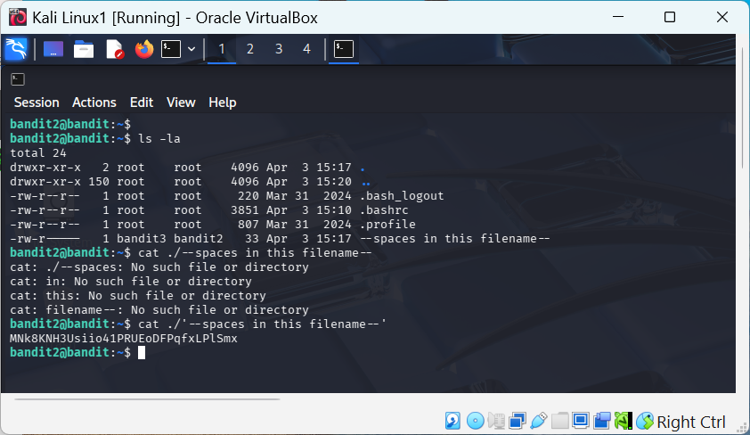

# Level 2 → Level 3

> 🔗 **OverTheWire page:** [Bandit Level 2 → Level 3](https://overthewire.org/wargames/bandit/bandit3.html)

## Topics Covered

- [Spaces in file names](#step-3) → wrap the name in quotation marks

## Level Goal

The password for the next level is stored in a file called `--spaces in this filename--` located in the home directory.

## Commands You May Need

- `ls`
- `cd`
- `cat`
- `file`
- `du`
- `find`

## Helpful Reading

Handling spaces in filenames.

## Solution

### Step 1

After connecting to the Bandit server using SSH (see the [SSH page](level0.md)), the goal is to read a file called `--spaces in this filename--` in the home directory.

As we are already in the home directory `~`, we can apply the command `ls` to check the available files. After finding the target file `--spaces in this filename--`, let's check its content by using the `cat` tool.

Oops, an error! But why? Simply because the shell interprets the file name as if it expects a flag again, as the file name starts with `-`. We discussed how to avoid this misinterpretation in the previous level. *To learn more about flags and dashed files, see the [previous level](level1-to-level2.md).*

### Step 2

To avoid this misinterpretation again, we will clearly set the location after `cat` using `./`, as `.` refers to the current directory followed by the name of the file.

```bash
cat ./--spaces in this filename--
```

Oops, an error again. What is the reason this time? Now the reason is different. It said: *No such file or directory.* It couldn't recognize the file while it already exists. That's mainly because the file name contains spaces. The shell interprets each word as a separate file name.

### Step 3

To avoid this error we should wrap the file name in quotation marks as follows:

```bash
cat ./"--spaces in this filename--"
```

See the image.


