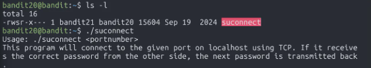

# Level 20 → Level 21

Interact with a setuid network program that validates the previous password.

> 🔗 **OverTheWire page:** [Bandit Level 20 → Level 21](https://overthewire.org/wargames/bandit/bandit21.html)

## Topics Covered

- [Netcat listener](#step-3) → make our own small server
- [setuid network client](#step-2) → a program that connects to our port

## Level Goal

There is a setuid binary in the home directory that does the following: it makes a connection to localhost on the port you specify as a command line argument. It then reads a line of text from the connection and compares it to the password in the previous level (bandit20). If the password is correct, it will transmit the password for the next level (bandit21).

## Commands You May Need

- [ssh](https://manpages.ubuntu.com/manpages/noble/man1/ssh.1.html)
- `nc`
- [cat](https://manpages.ubuntu.com/manpages/noble/man1/cat.1.html)
- `bash`
- `screen`
- `tmux`
- Unix 'job control' (`bg`, `fg`, `jobs`, `&`, `CTRL-Z`, …)

## Important Notes

> **NOTE:** Try connecting to your own network daemon to see if it works as you think

## Solution

### Step 1

**What we have**

Inside your home directory we have a binary file called:

```bash
./suconnect
```

This binary has **setuid permissions**, meaning:

- When YOU (bandit20) run it
- It actually runs as **bandit21**

So it has permission to read:

```bash
/etc/bandit_pass/bandit21
```

Just similar to the previous challenge. But the binary will **only reveal** that password if you prove you know the **bandit20** password.



### Step 2

**What the binary does (step by step)**

When you run:

```bash
./suconnect <portnumber>
```

It:

1. Connects to **localhost** (127.0.0.1 → your own machine)
2. Connects to the **port number you give it**
3. Reads **one line** of text from that connection
4. Compares what you sent to **the bandit20 password**
5. If your line is correct → it prints the **bandit21 password**

That's its entire behavior.

The binary is acting like a **client**. You must act like a **server**.

**✅ That is why we need to:**

1. Create a small "server" on your machine
2. Make that server send the **bandit20 password** to any client connecting
3. Run the setuid binary so it connects to your server
4. Your server sends the password
5. The binary checks it and returns the **bandit21 password**

Let's do all this (step by step). First, you need **two SSH sessions** open as bandit20. One acts as the server, the other runs the binary.

### Step 3

**Start a listener (server) using netcat**

In **Terminal 1**:

```bash
nc -lvp 4444
```

Meaning:

- `nc` → netcat (network tool)
- `-l` → listen mode
- `-v` → verbose
- `-p 4444` → port number 4444

Your terminal is now waiting for someone to connect.


### Step 4

**Run the setuid binary**

Open **Terminal 2**, log in again as bandit20, and run:

```bash
./suconnect 4444
```

This makes the binary:

✅ Connect to localhost:4444  
✅ Expect you to send a line containing the bandit20 password


### Step 5

**Send the bandit20 password**

In **Terminal 1** (where netcat is running):

As soon as the binary connects, you will see a connection message.

Now paste the **bandit20 password** (the one you used to log into this level), then press **ENTER**.

Netcat sends that line to the binary.

### Step 6

**Get the bandit21 password**

Go back to **Terminal 2**.

If you sent the correct password:

✅ The binary prints the **bandit21 password**  
✅ You are ready for the next level

Done!
