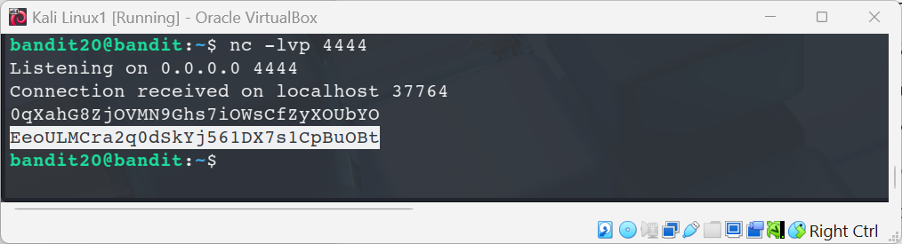
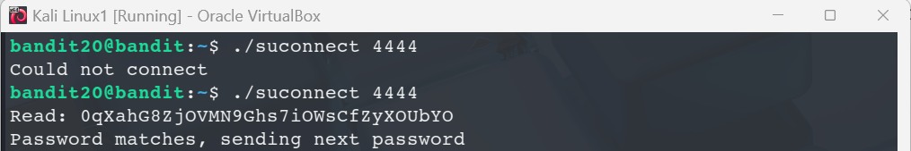

# Level 20 → Level 21

Interact with a setuid network program that validates the previous password.

> 🔗 **OverTheWire page:** [Bandit Level 20 → Level 21](https://overthewire.org/wargames/bandit/bandit21.html)

## Topics Covered

- [Netcat listener](#step-3) → make our own small server
- [setuid network client](#step-2) → a program that connects to our port

## Level Goal

There is a setuid binary in the home directory that does the following: it makes a connection to localhost on the port you specify as a command line argument. It then reads a line of text from the connection and compares it to the password in the previous level (bandit20). If the password is correct, it will transmit the password for the next level (bandit21).

## Commands You May Need

- [ssh](https://manpages.ubuntu.com/manpages/noble/man1/ssh.1.html)
- `nc`
- [cat](https://manpages.ubuntu.com/manpages/noble/man1/cat.1.html)
- `bash`
- `screen`
- `tmux`
- Unix 'job control' (`bg`, `fg`, `jobs`, `&`, `CTRL-Z`, …)

## Solution

### Step 1

**What we have**

Inside the home directory we have a binary file called:
``
./suconnect
`` if we look closely we found that this binary has **setuid permissions**, meaning: When we as `bandit20` run it, it actually runs as **bandit21**, so it has permission to read:
```bash
/etc/bandit_pass/bandit21
```

Just similar to the [previous challenge](./level19-to-level20.md). But the binary will **only reveal** that password if we prove that we know the **bandit20** password.


### Step 2

**What the binary does**

When we run:
``./suconnect <portnumber>`` it will conncts to **localhost** on the **port** number we gave it. Then it will read the text we sent to it to test weather it is really the `bandit20` password or not. If it is the correct password so it will print the password for the next level.

>The binary is acting like a **client**. we must act like a **server**.

**That is being said that we need to:**

1. Create a small "server" on our machine
2. Make that server send the **bandit20 password** to any client connecting
3. Run the setuid binary so it connects to our server
4. Our server sends the password
5. The binary checks it and returns the **bandit21 password**

Let's do all this. First, we need **two SSH sessions** open as bandit20. One acts as the server, the other runs the binary.

### Step 3

**Start a listener (server) using netcat**

In **Terminal 1**:

```bash
nc -lvp 4444
```

Meaning:

- `nc` → netcat (network tool)
- `-l` → listen mode
- `-v` → verbose
- `-p 4444` → port number 4444

Our terminal is now waiting for someone to connect.



### Step 4

**Run the setuid binary**

Open **Terminal 2**, log in again as bandit20, and run:

```bash
./suconnect 4444
```

This will do the job we explained above:



### Step 5

**Send the bandit20 password**

In **Terminal 1** (where netcat is running):

As soon as the binary connects, you will see a connection message.

Now paste the **bandit20 password**. Netcat will send that line to the binary.

### Step 6

**Get the bandit21 password**

Go back to **Terminal 2**. If you sent the correct password so the binary prints the **bandit21 password**  
