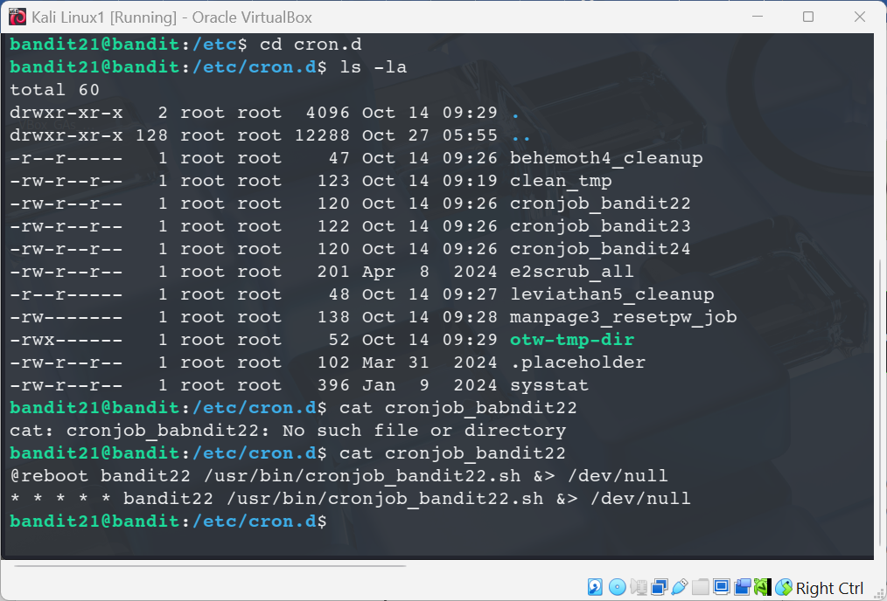
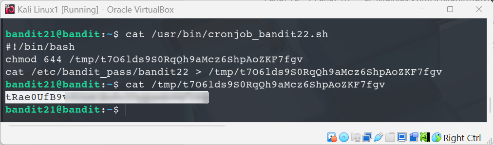

# Level 21 → Level 22

Inspect the cron job configuration in `/etc/cron.d/`.

> 🔗 **OverTheWire page:** [Bandit Level 21 → Level 22](https://overthewire.org/wargames/bandit/bandit22.html)

## Topics Covered

- [Cron jobs](#what-is-cron) → tasks that run automatically
- [Cron schedule](#understanding-the-cron-schedule) → the five time fields
- [Shebang](#1-what-is-a-shebang) → the first line of a script

## Level Goal

A program is running automatically at regular intervals from **cron**, the time-based job scheduler. Look in **/etc/cron.d/** for the configuration and see what command is being executed.

## Commands You May Need

- `cron`
- `crontab`
- `crontab(5)` (use `man 5 crontab` to access this)

## Solution

### Step 1

The challenge says cron and suggests checking the `/etc/cron.d/` directory, so the first step is to see what files exist there. Don't panic if you hear cron for the first time, it's an automated task, we will go through it thoroughly in the [theory below](#a-bit-of-theory).

```bash
cd /etc/cron.d
ls -la
```

Among the listed files, there is one named `cronjob_bandit22`.

### Step 2

Let's read the file to understand what task is being executed.

```bash
cat cronjob_bandit22
```

Output:

```text
@reboot bandit22 /usr/bin/cronjob_bandit22.sh &> /dev/null
* * * * * bandit22 /usr/bin/cronjob_bandit22.sh &> /dev/null
```

This shows that the script `/usr/bin/cronjob_bandit22.sh` is executed as the bandit22 user every minute.



### Step 3

Since the cron configuration only tells us which script runs, the next step is to inspect the script itself.

```bash
cat /usr/bin/cronjob_bandit22.sh
```

Output:

```bash
#!/bin/bash
chmod 644 /tmp/t7O6lds9S0RqQh9aMcz6ShpAoZKF7fgv
cat /etc/bandit_pass/bandit22 > /tmp/t7O6lds9S0RqQh9aMcz6ShpAoZKF7fgv
```

In simple words, the script copies the password stored in `/etc/bandit_pass/bandit22`, which is our target, into the file `/tmp/t7O6lds9S0RqQh9aMcz6ShpAoZKF7fgv`.

To understand more about the bash file, see the [shebang explanation below](#1-what-is-a-shebang).

### Step 4

The script also applies `chmod 644`, which makes the file readable by everyone on the system. Don't forget the permissions lesson before, see [Level 5 → Level 6](level5-to-level6-add-permession-level.md#d-search-by-permissions).

Reading the file reveals the password for the next level:

```bash
cat /tmp/t7O6lds9S0RqQh9aMcz6ShpAoZKF7fgv
```



## A Bit of Theory

### What is Cron?

**Cron** is a Linux system that automatically runs scripts or commands at scheduled times (every minute, hourly, daily, etc.).
It acts like a **timer-based robot** that executes tasks for users in the background without anyone logging in.

>The name comes from **"chronos" (time)**.

**Common real-world uses include:**

- Creating backups
- Cleaning temporary files
- Running monitoring scripts

> Note: in Linux it is usually located in the `/etc/cron.d/` directory.

### Understanding the Cron Schedule

The line that looks like:

```text
* * * * * bandit22 /usr/bin/cronjob_bandit22.sh
```

contains five time fields:

```text
┌──────── Minute
│ ┌────── Hour
│ │ ┌──── Day of Month
│ │ │ ┌── Month
│ │ │ │ ┌ Day of Week
│ │ │ │ │
* * * * *
```

If every field contains `*`, the job runs:

- Every minute
- Every hour
- Every day
- Every month
- Every day of the week

In other words: run the script once every minute.

### What if it starts with @reboot?

This means running **once every time the system restarts** (boot time).

> Note: if the line starts with `#`, it is a comment that usually tells us the purpose of the file and what it is doing.

### What user runs it?

`bandit22` → the script is executed **as bandit22**, not root and not you.

### What command runs?

`/usr/bin/cronjob_bandit22.sh`
This is the script being run at boot and every minute.

To understand the output redirection `&> /dev/null`, see [Level 6 → Level 7](level6-to-level7.md#what-is-a-file-descriptor-and-how-it-works).

To understand `chmod 644`, see the permissions theory in [Level 5 → Level 6](level5-to-level6-add-permession-level.md#d-search-by-permissions).

### 1. What is a shebang?

A **shebang** is the **first line** in a script that tells Linux **which interpreter** should run the script.

Example:

```bash
#!/bin/bash
```

This line tells the system: "Use the program located at `/bin/bash` to execute this file." Without it, Linux won't know how to run your script.

### 2. Why is it called "shebang"?

The word **shebang** comes from two symbols:

- `#` → **"sharp"** or **"hash"**
- `!` → **"bang"** in old Unix terminology

So `#` + `!` = `#!` → "shebang".

It's just a nickname that became common in Unix culture and documentation.

### 3. Why must the shebang be at the very beginning of the file?

Because the Linux kernel checks the **first two bytes** of a script. If the file starts with `#!`, Linux knows it's a script. It then reads the rest of the line to find **which program** should run it.

If the shebang is **not at the first line**, Linux won't detect it and you may get errors like:

```text
command not found
Exec format error
```

So the shebang **must** be line 1, column 1.
