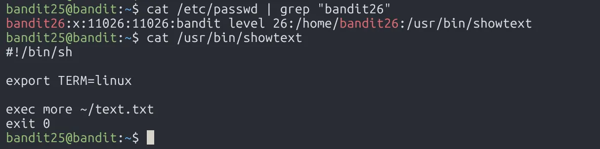
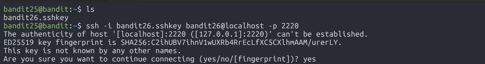
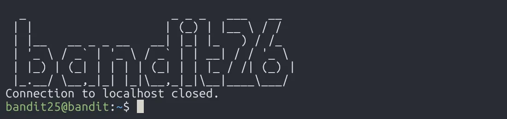
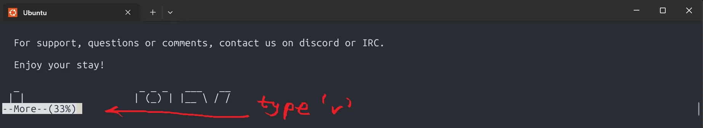
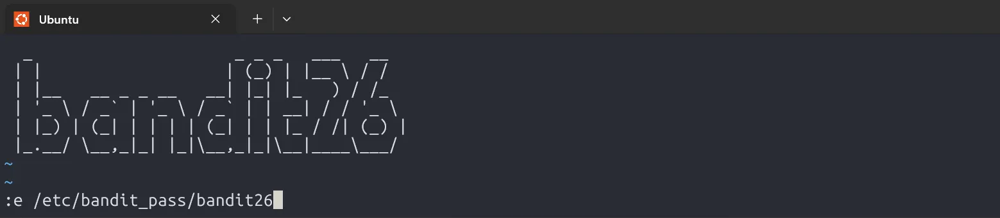
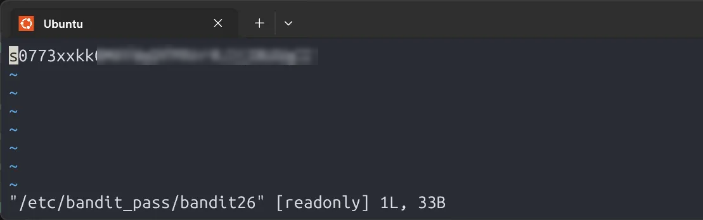

# Level 25 → Level 26

Find the shell of bandit26 and break out of it.

> 🔗 **OverTheWire page:** [Bandit Level 25 → Level 26](https://overthewire.org/wargames/bandit/bandit26.html)

## Topics Covered

- [Default shell of a user](#what-is-the-default-shell-of-a-user) → the last field in `/etc/passwd`
- [`more` and `vim`](#what-is-more) → break out of a restricted shell

## Level Goal

Logging in to bandit26 from bandit25 should be fairly easy… The shell for user bandit26 is not **/bin/bash**, but something else. Find out what it is, how it works and how to break out of it.

## Commands You May Need

- `ssh`
- `cat`
- `more`
- `vi`
- `ls`
- `id`
- `pwd`

## Solution

### Step 1

First, we need to know which shell the user bandit26 uses. This information is in the `/etc/passwd` file, at the end of the line of each user. So let's search for bandit26 only:

```bash
cat /etc/passwd | grep bandit26
```

The last part of the line is `/usr/bin/showtext`, so bandit26 doesn't use bash. It uses a program called `showtext`. Let's read it:

```bash
cat /usr/bin/showtext
```

```bash
#!/bin/sh

export TERM=linux

exec more ~/text.txt
exit 0
```

It's a small script that opens the file `text.txt` with the program `more`, and then exits.



### Step 2

When we list the home directory of bandit25, we find a private SSH key called `bandit26.sshkey`. We can use it to log in as bandit26, like we did in [Level 13 → Level 14](level13-to-level14.md).

```bash
ls
ssh -i bandit26.sshkey bandit26@localhost -p 2220
```



### Step 3

Oops, the connection closes immediately and we are back to the bandit25 shell.



What happened? Because bandit26's shell is `showtext`, it runs `more` on `text.txt` and then it exits. The text is very short, so `more` shows it all at once and finishes, and with it our connection.

### Step 4

The trick is to make the terminal window **very small** (just a few lines high) before we log in. Now `more` can't show the whole text, so it stops and waits for us with a `--More--` line at the bottom. This is the interactive mode of `more`.

**There is two way actually to navigate this level**  

1. The first one which I prefer is just to maximize the font size of the terminal and minimize the screen size so the  more word itself couldn't fit to the screen so it allows us to be in this interactive mode.

2. The second on is when the `--More--` line appears, press `v` to open the file in the editor (vim).



### Step 5

Now we are inside vim as bandit26. We can make the terminal window bigger again. In vim, we can open any file we are allowed to read with the `:e` command, so let's open the password file:

```text
:e /etc/bandit_pass/bandit26
```



The password is displayed.



## A Bit of Theory

### What is the default shell of a user?

Each user has a **default shell**. It is the program that starts when the user logs in. This is especially important with `ssh`, because this is the shell that will be displayed.

The default shell is saved at the end of the user's line in the `/etc/passwd` file. The line has this format:

```text
username:x:user_id:group_id:comment:home_directory:shell
```

For most users the shell is `/bin/bash`, but it can be any program, like in this level (`/usr/bin/showtext`).

### What is `more`?

`more` is a command that shows a file page by page. Its interactive mode only starts when the content of the file is too big to fit in the terminal window. That is why we made the window small.

Inside the interactive mode, we can press `v` to open the file in the editor. The editor is the one defined in the `VISUAL` or `EDITOR` variables, and if they are not set, `vim` is used.

### What is `vim`?

`vim` is a text editor that runs in the terminal. Besides editing, it can run commands. A few useful ones:

- `:e <file>` → open another file
- `:set shell=/bin/bash` → choose which shell vim uses
- `:shell` → open a shell from inside vim

We will use the last two in the next level.
