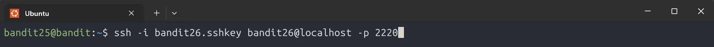
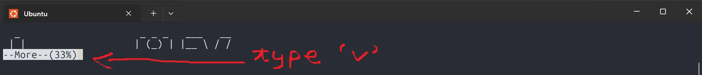
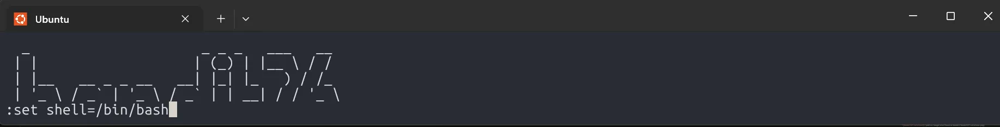
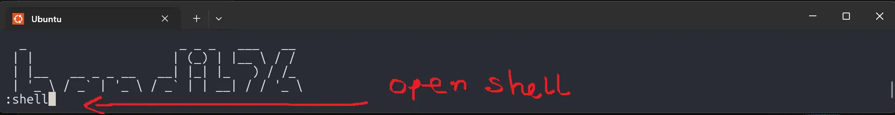
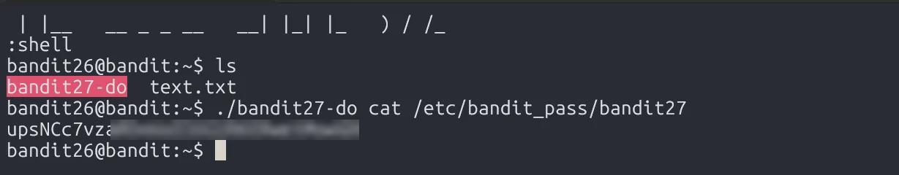

# Level 26 → Level 27

Retrieve the password after gaining a normal shell.

> 🔗 **OverTheWire page:** [Bandit Level 26 → Level 27](https://overthewire.org/wargames/bandit/bandit27.html)

## Topics Covered

- [Shell escape from vim](#why-does-set-shell-work) → `:set shell` and `:shell`
- [setuid binary](#what-is-a-setuid-binary) → run a command as another user

## Level Goal

Good job getting a shell! Now hurry and grab the password for bandit27!

## Commands You May Need

- `ls`

## Solution

In the previous level we escaped to the editor of bandit26, but we couldn't run normal commands there. This time we want a **real shell**, so we can run the program `bandit27-do`.

### Step 1

Log in as bandit26 again with the private key, exactly like in the previous level, from the bandit25 account:

```bash
ssh -i bandit26.sshkey bandit26@localhost -p 2220
```



### Step 2

Remember to make the terminal window small before logging in. When the `--More--` line appears, press `v` to open vim.



### Step 3

Inside vim, we can try the `:shell` command to open a shell. But `:shell` uses the **default shell of the user**, and for bandit26 it is `showtext`, so it will just close again. That's why we first set the shell that vim should use:

```text
:set shell=/bin/bash
```



### Step 4

Now we open the shell:

```text
:shell
```



Finally, we have a normal shell as bandit26.

### Step 5

Let's see what is in the home directory:

```bash
ls
```

There is a file called `bandit27-do`. It is a setuid binary, like the one we saw in [Level 19 → Level 20](level19-to-level20.md), so it runs the command we give it as the user bandit27. Let's use it to read the password:

```bash
./bandit27-do cat /etc/bandit_pass/bandit27
```



## A Bit of Theory

### Why does `:set shell` work?

The `:shell` command of vim starts the program saved in vim's `shell` option. By default, this option is the default shell of the user. For bandit26 that is `showtext`, which closes immediately.

When we change the option with `:set shell=/bin/bash`, vim starts bash instead, and we get a normal shell.

### What is a setuid binary?

A setuid binary is a program that runs with the permissions of its **owner**, not the user who runs it. We explained it in detail in [Level 19 → Level 20](level19-to-level20.md#what-do-setuid-and-setgid-actually-mean-and-how-to-set-them).

Here `bandit27-do` is owned by bandit27, so when we write:

```bash
./bandit27-do <command>
```

the command runs as bandit27 and can read `/etc/bandit_pass/bandit27`.
