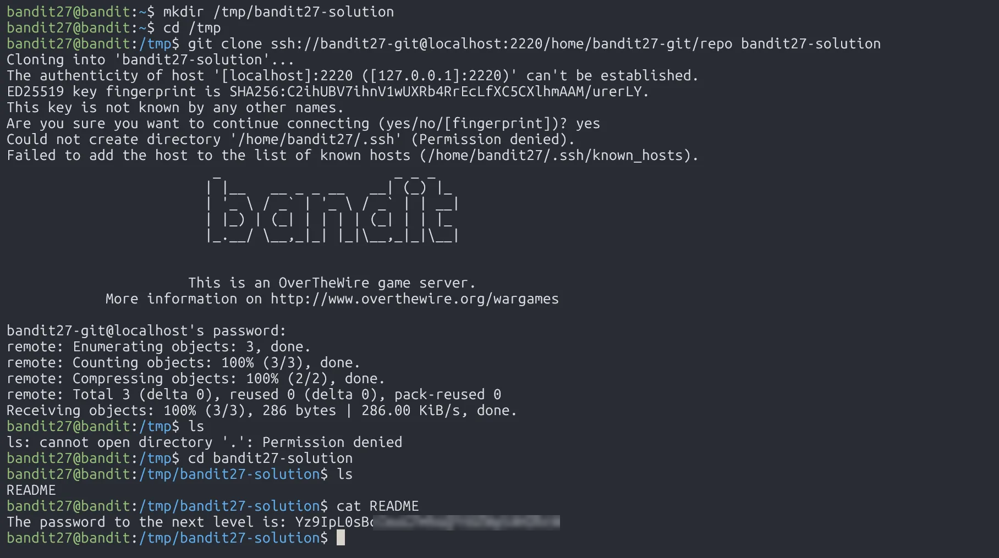

# Level 27 → Level 28

Clone a remote git repository to find the password.

> 🔗 **OverTheWire page:** [Bandit Level 27 → Level 28](https://overthewire.org/wargames/bandit/bandit28.html)

## Topics Covered

- [Git and `git clone`](#what-is-git) → copy a repository from a server
- [Why `/tmp`](#why-do-we-use-tmp) → the folder where we can write

## Level Goal

There is a git repository at `ssh://bandit27-git@localhost/home/bandit27-git/repo` via the port `2220`. The password for the user `bandit27-git` is the same as for the user `bandit27`.

Clone the repository and find the password for the next level.

## Commands You May Need

- `git`

## Solution

### Step 1

This level is not about logging in with `ssh` only. We have a **git repository** on the server, and we need to copy it to our own folder using `git clone`.

We are not allowed to create files in the home directory, so first we create a folder in `/tmp`:

```bash
mkdir /tmp/bandit27-solution
cd /tmp
```

### Step 2

Now let's clone the repository. Notice that we write the port `2220` inside the address:

```bash
git clone ssh://bandit27-git@localhost:2220/home/bandit27-git/repo bandit27-solution
```

Git asks us if we trust the host, so we type `yes`. Then it asks for the password of `bandit27-git`, which is the password of bandit27.

> The message *Failed to add the host to the list of known hosts* is normal here, because we don't have permission to write in the home directory.

### Step 3

After the clone finishes, let's go into the folder and look for the password:

```bash
cd bandit27-solution
ls
cat README
```



## A Bit of Theory

### What is Git?

Git is a tool that keeps the history of the changes in a project. A project folder that is tracked by git is called a **repository** (or repo). Every change is saved as a **commit**.

### What does `git clone` do?

`git clone` makes a copy of a repository, including all its history, from a remote place to our computer (or in this case, to our folder in `/tmp`).

```bash
git clone <address> <folder-name>
```

### The address of the repository

In this level, the address looks like this:

```text
ssh://bandit27-git@localhost:2220/home/bandit27-git/repo
```

- `ssh://` → git connects using the SSH protocol
- `bandit27-git` → the user name
- `localhost` → the machine (the same server we are on)
- `2220` → the SSH port
- `/home/bandit27-git/repo` → the path of the repository

### Why do we use `/tmp`?

In the Bandit levels, we usually can't write in our home directory, but everyone can create files and folders in `/tmp`. We used `mktemp` before for the same reason, see [Level 12 → Level 13](level12-to-level13.md#-what-is-mktemp).
