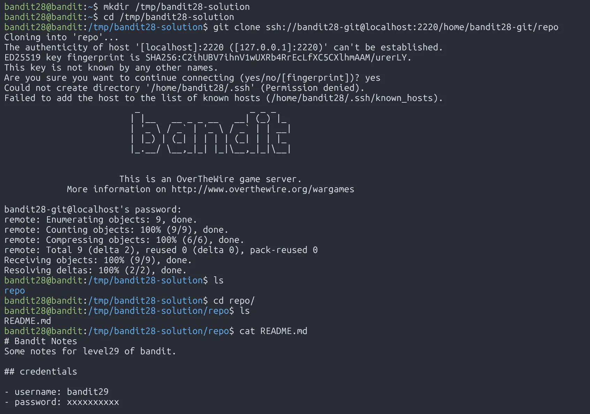
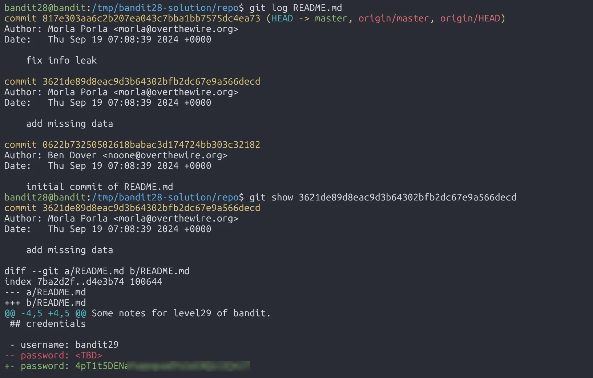

# Level 28 → Level 29

Search the git history for removed secrets.

> 🔗 **OverTheWire page:** [Bandit Level 28 → Level 29](https://overthewire.org/wargames/bandit/bandit29.html)

## Topics Covered

- [Commits and history](#what-is-a-commit) → git remembers old versions
- [`git log` and `git show`](#git-log) → read the history and the changes

## Level Goal

There is a git repository at `ssh://bandit28-git@localhost/home/bandit28-git/repo` via the port `2220`. The password for the user `bandit28-git` is the same as for the user `bandit28`.

Clone the repository and find the password for the next level.

## Commands You May Need

- `git`

## Solution

### Step 1

Same as the previous level, we create a folder in `/tmp` and clone the repository into it. Remember, the password of `bandit28-git` is the password of bandit28.

```bash
mkdir /tmp/bandit28-solution
cd /tmp/bandit28-solution
git clone ssh://bandit28-git@localhost:2220/home/bandit28-git/repo
```

### Step 2

Let's go into the repository and read the README file:

```bash
ls
cd repo/
ls
cat README.md
```

Oops, the password is hidden! The file only shows `xxxxxxxxxx` instead of the real password.



### Step 3

Somebody removed the password from the file, but git remembers all the old versions. Let's look at the history of this file with `git log`:

```bash
git log README.md
```

We see three commits. The latest one is called *fix info leak*, so the password was probably removed there. The commit before it is called *add missing data*, so it is the one that added the password. Let's look at what changed in that commit using `git show` and its commit hash:

```bash
git show <commit-hash>
```

### Step 4

In the output, the lines with `-` (in red) are what was removed, and the lines with `+` (in green) are what was added. In that commit, the placeholder was replaced by the real password, so we found the password for the next level.



## A Bit of Theory

### What is a commit?

A commit is a saved version of the project at a specific time. Every commit has:

- a long **hash** that identifies it
- the author and the date
- a short message that describes the change

That is why git is useful, and also why secrets are dangerous: **deleting a password in a new commit doesn't delete it from the history.**

### `git log`

`git log` shows the list of commits, the newest first. If we add a file name, like `git log README.md`, it shows only the commits that changed that file.

### `git show`

`git show <commit-hash>` shows the details of one commit, including exactly what lines changed.

### How to read a diff

```text
- password: <TBD>
+ password: <the real password>
```

- Lines starting with `-` were removed from the file.
- Lines starting with `+` were added to the file.
