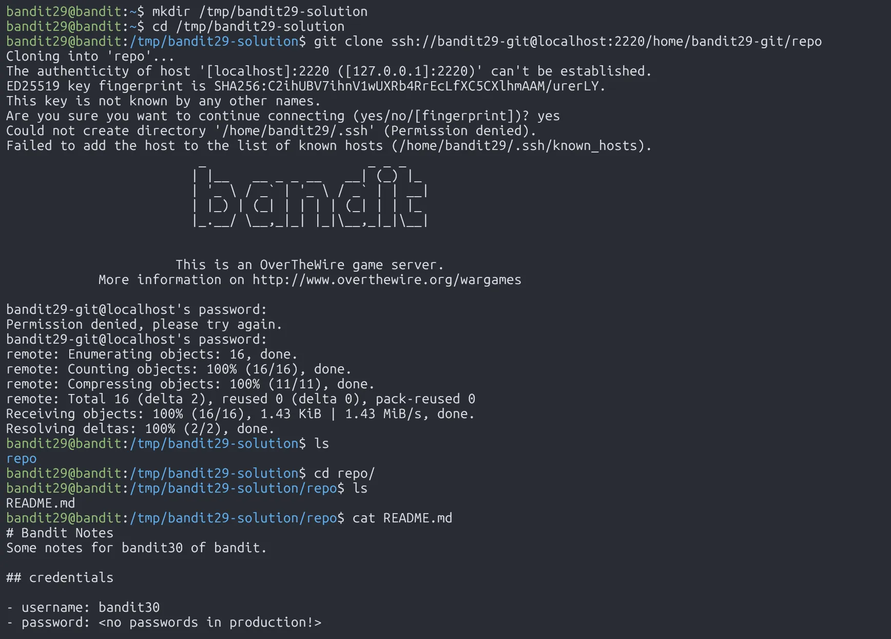
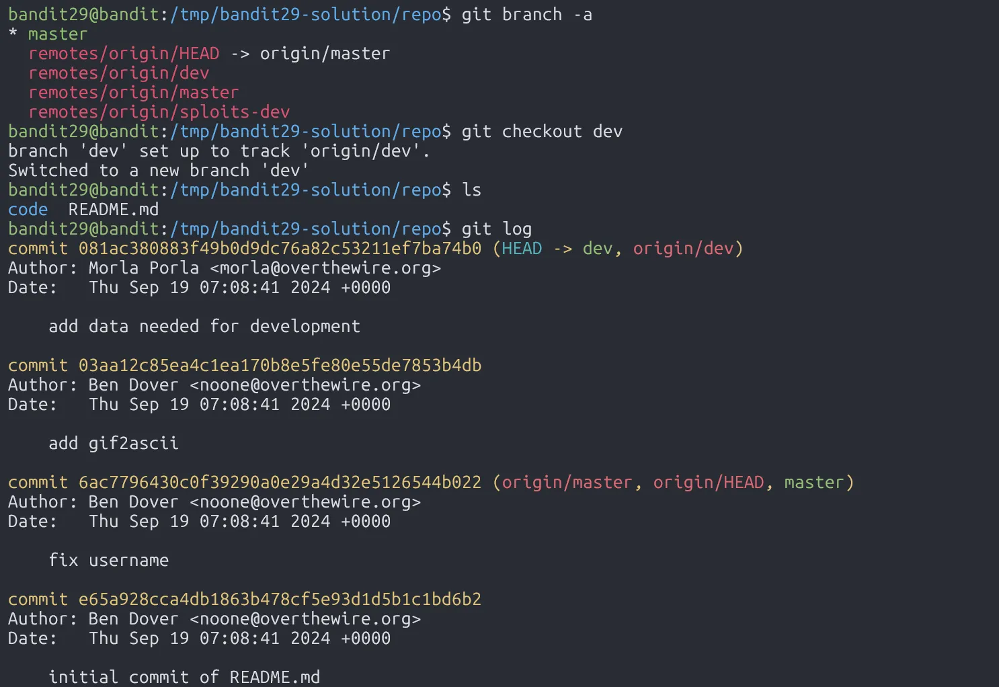
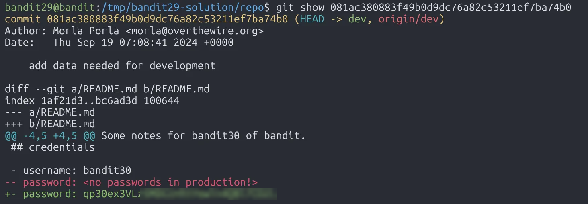

# Level 29 → Level 30

Recover credentials from a different git branch.

> 🔗 **OverTheWire page:** [Bandit Level 29 → Level 30](https://overthewire.org/wargames/bandit/bandit30.html)

## Topics Covered

- [Branches](#what-is-a-branch) → different lines of work in one repository
- [`git branch -a` and `git checkout`](#git-branch--a) → find and switch to another branch

## Level Goal

There is a git repository at `ssh://bandit29-git@localhost/home/bandit29-git/repo` via the port `2220`. The password for the user `bandit29-git` is the same as for the user `bandit29`.

Clone the repository and find the password for the next level.

## Commands You May Need

- `git`

## Solution

### Step 1

As usual, create a folder in `/tmp` and clone the repository. The password of `bandit29-git` is the password of bandit29.

```bash
mkdir /tmp/bandit29-solution
cd /tmp/bandit29-solution
git clone ssh://bandit29-git@localhost:2220/home/bandit29-git/repo
```

### Step 2

Let's read the README file:

```bash
cd repo/
cat README.md
```

The password line says `<no passwords in production!>`. So the password is not in this version of the file. Maybe it is in another place of the repository, the development part.



### Step 3

A repository can have different **branches**. Let's list all of them, including the remote ones, with the `-a` flag:

```bash
git branch -a
```

We see a branch called `dev`. Let's switch to it and check the files and the history:

```bash
git checkout dev
ls
git log
```

The latest commit is called *add data needed for development*. That sounds interesting!



### Step 4

Let's see what changed in that commit using its hash:

```bash
git show <commit-hash>
```

The line with `+` shows the password of the next level.



## A Bit of Theory

### What is a branch?

A branch is a separate line of work in a repository. Developers use branches to work on new things (like `dev`) without touching the main version (`master`). Each branch can have different files and different commits.

When we clone a repository, we only start on the main branch, so we must look for the other ones.

### `git branch -a`

By default, `git branch` shows only the local branches. The `-a` flag means **all**, so it shows the remote branches too:

```text
* master
  remotes/origin/HEAD -> origin/master
  remotes/origin/dev
  remotes/origin/sploits-dev
```

The branches that start with `remotes/origin/` are the ones that exist on the server.

### `git checkout <branch>`

`git checkout dev` switches our folder to the `dev` branch. Git creates a local `dev` branch that follows `origin/dev`, and the files change to the version of that branch.
