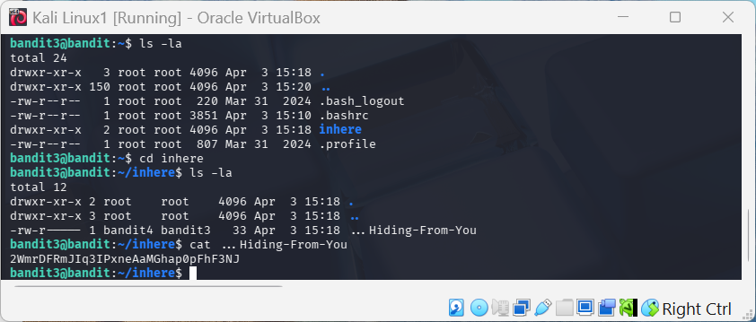

# Level 3 → Level 4

> 🔗 **OverTheWire page:** [Bandit Level 3 → Level 4](https://overthewire.org/wargames/bandit/bandit4.html)

## Topics Covered

- [Hidden files](#what-is-a-hidden-file) → files that start with a dot
- [Paths](#how-to-determine-a-path-of-a-filedir-use-pwd-command) → absolute and relative paths, `pwd` and `cd`

## Level Goal

The password for the next level is stored in a hidden file inside the `inhere` directory.

## Commands You May Need

- `ls`
- `cd`
- `cat`
- `file`
- `find`

## Solution

### Step 1

After connecting to the Bandit server using SSH (see the [SSH page](level0.md)), the task is to read a hidden file in the `inhere` directory.

As we are already in the home directory `~`, we can try to list files and directories in the `inhere` directory using the `ls -la` command.

```bash
ls -la inhere
```

As we said, the `-a` flag allows us to show even hidden files and directories starting with `.`

### Step 2

From the result, there is a file called `...Hiding-From-You`. We can try to `cat` this file. Be sure to determine the path of the target file, see [below](#a-bit-of-theory).

```bash
cat inhere/...Hiding-From-You
```



## A Bit of Theory

### What is a hidden file?

A hidden file/directory is a file or directory starting with **.**

Examples:

`.bashrc`

`.ssh`

`.profile`

`.hidden_file`

Linux treats these files as hidden.

You can't see them when using ls by default

To see them use -a flag: ls -a

### Are they secure?

**No, hidden files are *not* secure in Linux just because they are hidden.**  
But they *can* be part of a secure setup **when combined with proper permissions**.

Hidden files:

- are **not encrypted**

- are **not protected**

- can be seen by anyone who knows ls -a

- can be opened by any user with read permission

### So why we use them?

Hidden files are commonly used for:

- configuration

- settings

- user preferences

- storing private keys

- storing shell configs

> We use hidden files to organize and avoid clutter the directory, not for security reasons.

### How to determine a path of a file/dir. Use pwd command

The location of any file or directory is described by its path.

A path is a sequence of directories that leads from a starting point to a specific destination.

When navigating through the filesystem, it is essential to know your current working directory. The easiest way to know where you are is by using `` pwd `` command short for: print working directory. It aims to print the absolute path starting from the root `` / ``

### How to navigate through the file system. Use cd command

We use cd short for change directory to change the current directory to the target location aka path

Let's talk more about path:

There are two ways to describe a path of a file/dir

1.  **absolute path**

The full path to a specific file starting with the root directory `` / ``

The `` / `` is the top-level directory in the filesystem. Everything starts from it.

For instance: `` cd /home/bandit3/inhere ``

2.  **relative path**

This path is relative to where are you now.

It doesn't require you to type the whole path from `` / `` while you can start from the current directory

If you are in a directory and want to navigate to any subdirectory use the relative path

For instance: `` cd inhere `` when you standing in the `` home `` directory

useful tips and tricks:

- we refer to home directory by `` ~ ``

- when you type `` cd `` without any further parameters it will navigate you directly to the `` home `` directory

- if you notice before the result of applying `` ls -a `` of any given folder, the result usually start with something like

**``.``**

**``. .``**

The ``.`` refers to the current directory, while ``. .`` refers to the previous (parent) directory

- ``cd ./"anything-inside-current-directory"`` to determine any target file/dir for specific reason

- ``cd . ./"anything-inside-parent-directory`` navigate you the parent directory
