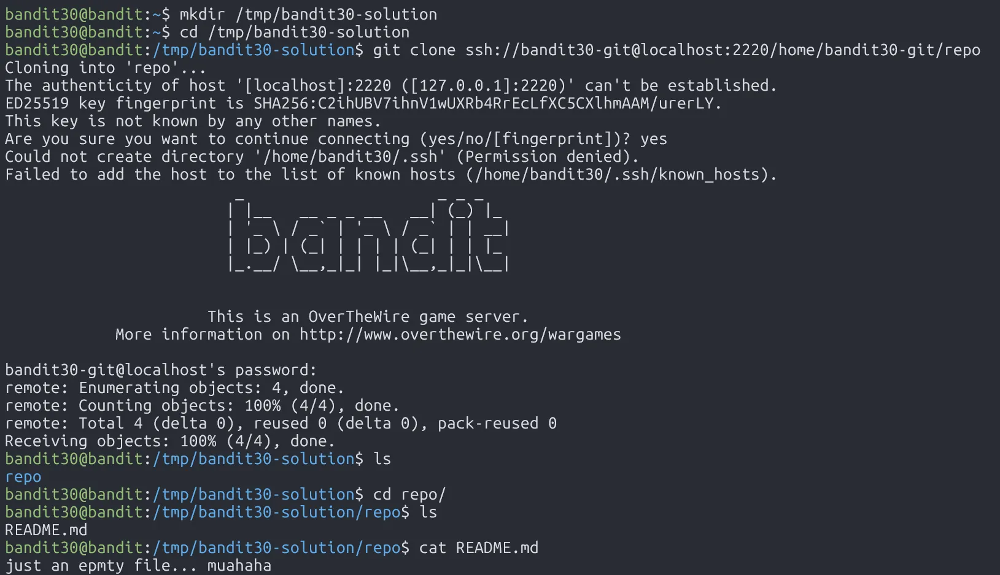
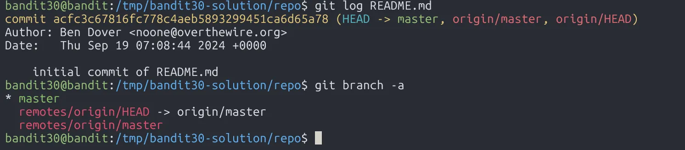
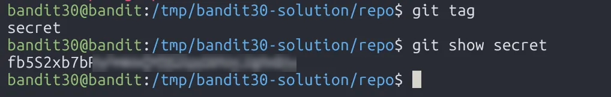

# Level 30 → Level 31

Find hidden data inside git objects.

> 🔗 **OverTheWire page:** [Bandit Level 30 → Level 31](https://overthewire.org/wargames/bandit/bandit31.html)

## Topics Covered

- [Git tags](#what-is-a-git-tag) → bookmarks that hide secrets

## Level Goal

There is a git repository at `ssh://bandit30-git@localhost/home/bandit30-git/repo` via the port `2220`. The password for the user `bandit30-git` is the same as for the user `bandit30`.

Clone the repository and find the password for the next level.

## Commands You May Need

- `git`

## Solution

### Step 1

We do the same first steps: create a folder in `/tmp`, clone the repository and read the README file.

```bash
mkdir /tmp/bandit30-solution
cd /tmp/bandit30-solution
git clone ssh://bandit30-git@localhost:2220/home/bandit30-git/repo
cd repo/
cat README.md
```

The README only says that it is an empty file. Nothing useful here.



### Step 2

Let's check the history and the branches like the previous levels:

```bash
git log README.md
git branch -a
```

There is only one commit, and only the `master` branch. So the password is not in the commits or the branches.



### Step 3

There is one more thing that git can store: **tags**. Let's list them:

```bash
git tag
```

There is a tag called `secret`. Let's see what it contains:

```bash
git show secret
```

It shows the password for the next level.



## A Bit of Theory

### What is a git tag?

A tag is a name that we put on a specific point in the history, usually to mark a version, like `v1.0`. It is like a bookmark.

Tags don't appear when we list the branches or read the log of the files, so they are easy to miss.

### `git tag`

`git tag` shows the list of all tags in the repository.

### `git show <tag-name>`

`git show secret` shows what the tag points to. A tag can also have its own message. In this level, the message of the tag is the password.
