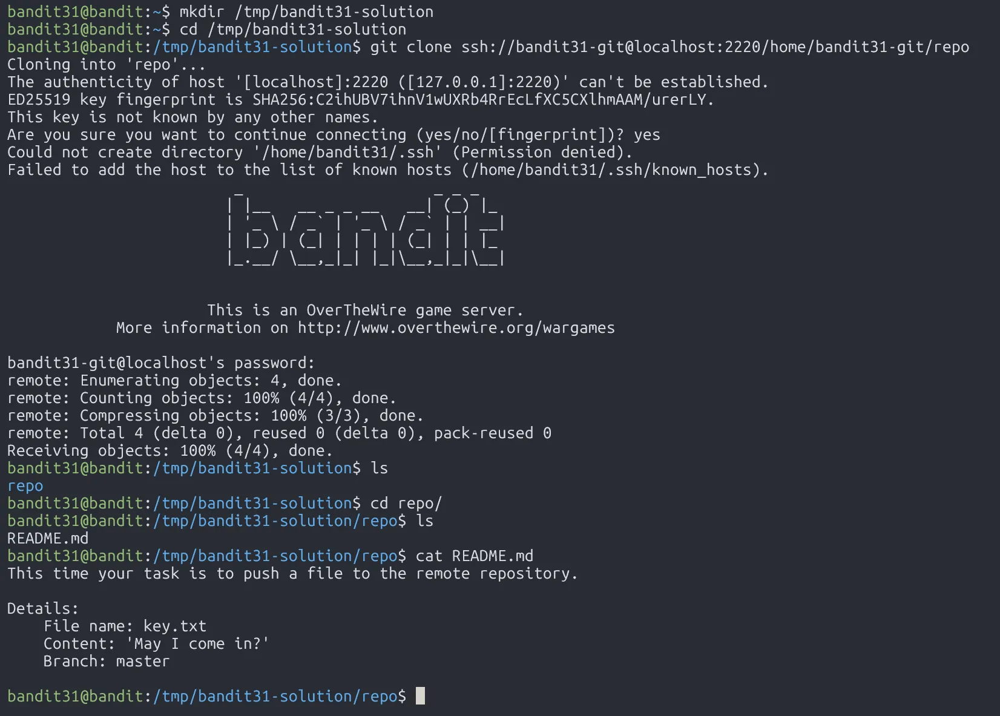
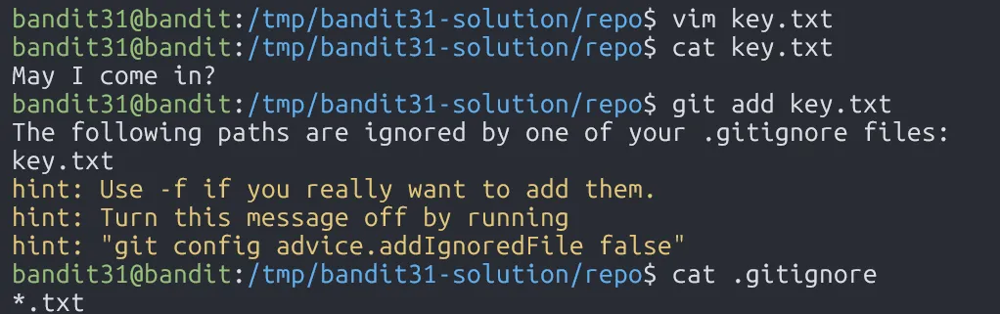
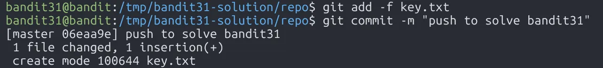
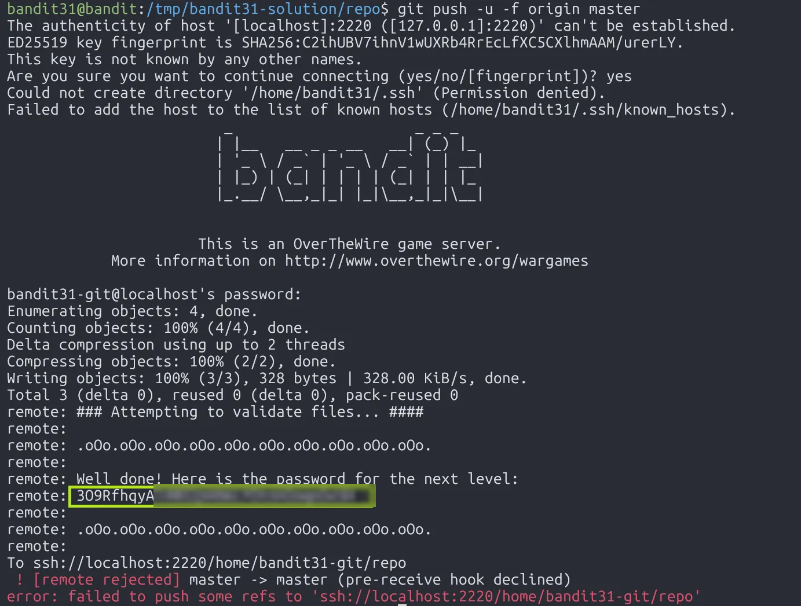

# Level 31 → Level 32

Push a file to the remote git repository.

> 🔗 **OverTheWire page:** [Bandit Level 31 → Level 32](https://overthewire.org/wargames/bandit/bandit32.html)

## Topics Covered

- [`.gitignore`](#what-is-gitignore) → files that git ignores
- [`git add -f`, commit and push](#git-add--f) → send our file to the remote repository

## Level Goal

There is a git repository at `ssh://bandit31-git@localhost/home/bandit31-git/repo` via the port `2220`. The password for the user `bandit31-git` is the same as for the user `bandit31`.

Clone the repository and find the password for the next level.

## Commands You May Need

- `git`

## Solution

### Step 1

Same as before, we create a folder in `/tmp`, clone the repository and read the README file.

```bash
mkdir /tmp/bandit31-solution
cd /tmp/bandit31-solution
git clone ssh://bandit31-git@localhost:2220/home/bandit31-git/repo
cd repo/
cat README.md
```

This time the task is different. We should **push a file to the remote repository**:

```text
File name: key.txt
Content: 'May I come in?'
Branch: master
```



### Step 2

Let's create the file with the content they asked for and try to add it to git:

```bash
vim key.txt
cat key.txt
git add key.txt
```

Oops, git refuses to add the file and says that the path is ignored by one of the `.gitignore` files. Let's check that file:

```bash
cat .gitignore
```

It contains `*.txt`, so git ignores every file that ends with `.txt`.



### Step 3

The hint of git tells us what to do: use `-f` if we really want to add the file. This forces git to add it even if it is ignored. Then we save the change with a commit:

```bash
git add -f key.txt
git commit -m "push to solve bandit31"
```



### Step 4

Now we push the commit to the remote repository, on the `master` branch:

```bash
git push -u origin master
```

Git asks for the password of `bandit31-git`. Then the server checks our file and answers with a message that contains the password for the next level.



## A Bit of Theory

### What is `.gitignore`?

`.gitignore` is a file that tells git which files it should **ignore**. Developers use it for files that shouldn't be saved in the repository, like temporary files or passwords.

```text
*.txt
```

This line means: ignore every file that ends with `.txt`.

### `git add -f`

`git add` prepares a file to be saved in the next commit. The `-f` flag means **force**, so it adds the file even if it matches a pattern in `.gitignore`.

### `git commit`

`git commit -m "message"` saves the prepared files as a new commit in our local repository. The message should describe the change.

### `git push`

`git push` sends our local commits to the remote repository.

```bash
git push -u origin master
```

- `origin` → the name of the remote repository (the server we cloned from)
- `master` → the branch we are pushing to

### Why did the server answer with the password?

The remote repository checks the pushed files, and if they are correct (the right file name, the right content and the right branch), it prints the password in its response. That is why we see the lines that start with `remote:`.
