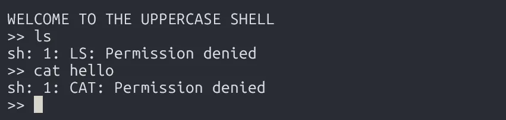
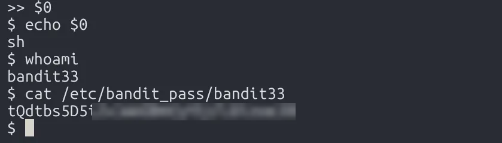

# Level 32 → Level 33

Escape from the uppercase shell.

> 🔗 **OverTheWire page:** [Bandit Level 32 → Level 33](https://overthewire.org/wargames/bandit/bandit33.html)

## Topics Covered

- [`$0` shell escape](#what-is-0) → run a new shell without using letters

## Level Goal

After all this git stuff, it's time for another escape. Good luck!

## Commands You May Need

- `sh`
- `echo`
- `whoami`

## Solution

### Step 1

Log in as bandit32 with the password we got. Instead of a normal prompt, we see a strange message:

```text
WELCOME TO THE UPPERCASE SHELL
```

Let's try some normal commands:

```text
>> ls
sh: 1: LS: Permission denied
>> cat hello
sh: 1: CAT: Permission denied
```

Every command we type is changed to **UPPERCASE** before it runs, and the uppercase commands (`LS`, `CAT`) don't exist in Linux, because Linux is case sensitive. So we need a command that has no letters, so the uppercase can't change it.



### Step 2

The solution is the variable `$0`. Let's type it:

```text
>> $0
```

It opens a new shell, and now we are out of the uppercase shell. Let's check which shell we are in and who we are:

```bash
echo $0
whoami
```

We are in `sh`, and the user is **bandit33**.

### Step 3

Now we are free to read the password of the next level:

```bash
cat /etc/bandit_pass/bandit33
```



## A Bit of Theory

### What is `$0`?

In the shell, `$0` is a special variable that holds the **name of the shell (or script) that is running**. When we type `$0` as a command, the shell replaces it with its own name, which is `sh`, and so it starts a new `sh`.

### Why does it work in the uppercase shell?

The uppercase shell changes letters to capital letters, but `$0` has **no letters**: it is only a dollar sign and a number. So the uppercase can't break it.

### Why are we bandit33 now?

The uppercase shell runs as the user bandit33 (it is a setuid program, see [Level 19 → Level 20](level19-to-level20.md)). The new `sh` that we opened from it keeps the same user, so we can read `/etc/bandit_pass/bandit33`.
