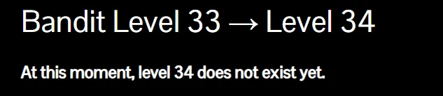

# Level 33 → Level 34

The last level of Bandit, for now.

> 🔗 **OverTheWire page:** [Bandit Level 33 → Level 34](https://overthewire.org/wargames/bandit/bandit34.html)

## Topics Covered

- [End of Bandit](#a-bit-of-theory) → what comes next

## Level Goal

At this moment, level 34 does not exist yet.

## Commands You May Need

- `ls`
- `cat`

## Solution

### Step 1

Log in as bandit33 using the password from the previous level:

```bash
ssh bandit33@bandit.labs.overthewire.org -p 2220
```

### Step 2

In the home directory, there is a file that explains the situation. Let's list the files and read it:

```bash
ls
cat README.txt
```

The message says that this was the last level, and that there are no more levels to play in Bandit at this moment. The OverTheWire team may add new levels later.



## A Bit of Theory

This level doesn't have a new topic. The next games in this repository are Natas and Leviathan, see the [main README](../README.md).
