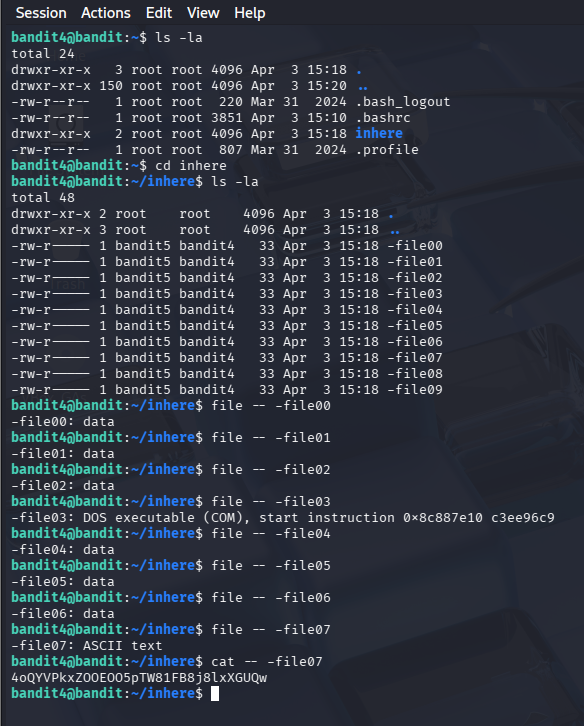

# Level 4 → Level 5

> 🔗 **OverTheWire page:** [Bandit Level 4 → Level 5](https://overthewire.org/wargames/bandit/bandit5.html)

## Topics Covered

- [Human-readable files](#what-does-humanreadable-file-mean) → and how to check them with `file`

## Level Goal

The password for the next level is stored in the only human-readable file in the `inhere` directory.

## Important Notes

> Tip: use the `reset` command if your terminal breaks.

## Solution

### Step 1

After connecting to the Bandit server using SSH (see the [SSH page](level0.md)), the call is to read the only readable file inside the `inhere` directory.

As we are already in the home directory `~`, we can try to change the directory to `inhere` and list the files and directories inside it using the `ls -la` command.

```bash
cd inhere
ls -la
```

### Step 2

To check the type of data inside a file without reading its content, we can use the command `file [filename]`.

```bash
file -- -file07
```



After testing, we found that the only human-readable file is `-file07`.

### Step 3

Let's `cat` it.

```bash
cat -- -file07
```

## A Bit of Theory

### What Does “Human‑Readable File” Mean?

A **human‑readable file** is a file whose contents can be **easily understood by a human** by simply opening it using usual commands: cat, less, more

They are easy to read because they contain **ASCII characters** (letters, numbers, symbols).

### What Is *NOT* a Human‑Readable File?

A file that contains **binary data** is *not* human-readable.

Example:

�๛x��R^;@��

You will see weird symbols.

This includes:

- images (.jpg, .png)

- executables (ELF files)

- compressed files (.zip, .tar.gz)

- compiled programs

- audio/video files

These require **special programs**, not plain text readers.

### How to Check If a File Is Human‑Readable

**1. Use cat or less:**

```bash
cat file
```

If it prints normal text → human‑readable.  
If it prints garbage → not human-readable.

**2. Use the file command:**

```bash
file file01
```

Examples of output:

ASCII text

UTF-8 text

PNG image data

ELF 64-bit LSB executable

If it says:

- ASCII text

- UTF-8 text

so it is **Human‑readable**

If it says:

- binary

- data

- image

- executable

it is **NOT human‑readable**
