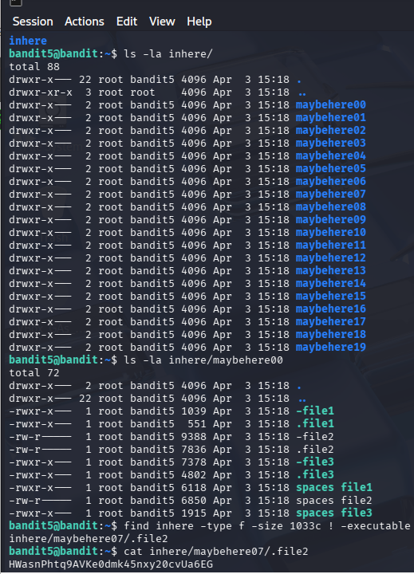

# Level 5 → Level 6

> 🔗 **OverTheWire page:** [Bandit Level 5 → Level 6](https://overthewire.org/wargames/bandit/bandit6.html)

## Topics Covered

- [`find` command](#general-syntax) → search files by type, size, name and permissions

## Level Goal

The password for the next level is stored in a file somewhere under the `inhere` directory and has all of the following properties:

- human-readable
- exactly 1033 bytes in size
- not executable

## Commands You May Need

- `ls`
- `cd`
- `cat`
- `file`
- `du`
- `find`

## Solution

### Step 1

After connecting to the Bandit server using SSH (see the [SSH page](level0.md)), the call is to read a file inside the `inhere` directory with specific specifications.

If we list the `inhere` directory, we will have multiple directories, and if we list one of them, we will run into another bunch of files. If we decided to check them one by one, we would run out of time. That would be impossible.



### Step 2

The more efficient way is to use the `find` command. We use `find` to filter files and directories according to specific restrictions. To learn more about the `find` command, see [below](#a-bit-of-theory).

```bash
find inhere -type f -size 1033c ! -executable
```

### Step 3

Let's `cat` it.

```bash
cat inhere/maybehere07/.file2
```

## A Bit of Theory

find is a command‑line tool used to **search for files and directories** based on specific criteria. It can also **perform actions** on the files it finds.

### General Syntax

```bash
find [path] [conditions] [actions]
```

Example:

```bash
find /home -type f -name "*.txt"
```

This means:

- search in /home

- look for **files** (-type f)

- with name ending in .txt

### 1. PATH: Where find Should Search

Examples:

- `find .` → search current directory

- `find /etc` → search system config files

- `find /home` → search user directories

- `find inhere` → Bandit challenge

You can specify multiple paths at once:

```bash
find /etc /var -type f
```

### 2. CONDITIONS: What You Are Searching For

This is where find becomes powerful.

Below are the most important condition options, grouped logically.

### A. Search by File Type

| **Flag** | **Meaning**      |
|----------|------------------|
| -type f  | search for files |
| -type d  | directories      |
| -type l  | symbolic links   |

Example:

```bash
find /var -type d
```

### B. Search by Name

```bash
find . -name "file.txt"
```

Case‑insensitive:

```bash
find . -iname "file.txt"
```

Wildcard example:

```bash
find . -name "*.log"
```

### C. Search by Size

Very important for Bandit.

Examples:

**Exact size in bytes:**

```bash
find . -size 1033c
```

(c = bytes)

**Exact size in kilobytes:**

```bash
find . -size 5k
```

**Greater than:**

```bash
find . -size +5M
```

**Less than:**

```bash
find . -size -10k
```

### D. Search by Permissions

Examples:

**Find files that are not executable:**

```bash
find . ! -executable
```

**Find files with 777 permissions: we will discuss permissions more deeply in the next level walkthrough**

```bash
find . -perm 777
```

**Find files writable by others:**

```bash
find . -perm -o=w
```

### E. Search by Owner or Group

We will discuss users and groups more deeply in a later level.

```bash
find . -user bandit7
find . -group staff
```

### F. Search by Time

**Modified within last 1 day:**

```bash
find . -mtime -1
```

**Modified more than 7 days ago:**

```bash
find . -mtime +7
```

### G. Combining Conditions

You can combine multiple requirements using **AND** (default), **OR**, and **NOT**.

**AND (default):**

```bash
find . -type f -size 1033c ! -executable
```

This is EXACTLY what Bandit Level 5 requires.


**NOT:**

```bash
find . ! -name "*.txt"
```

### 3. ACTIONS: What Should Happen When a File Is Found?

### 📌 ``-print`` (default)

Show the file path.

```bash
find . -name "*.txt" -print
```

### 📌 ``-exec`` Execute a command on each matched file

Syntax:

```bash
find . -type f -exec COMMAND {} \;
```

Example: delete all ``.tmp`` files

```bash
find . -name "*.tmp" -exec rm {} \;
```

Example: show the content of each file

```bash
find . -type f -exec cat {} \;
```

### 📌 ``-delete`` Delete found files (BE CAREFUL)

```bash
find . -name "*.bak" -delete
```

From discussing `find`, we can see it is the best tool to filter files and directories when manual search is impossible.
