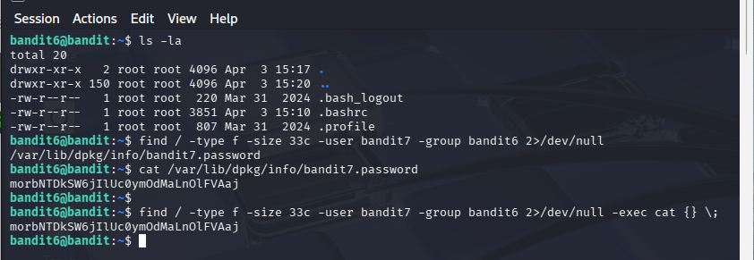

# Level 6 → Level 7

> 🔗 **OverTheWire page:** [Bandit Level 6 → Level 7](https://overthewire.org/wargames/bandit/bandit7.html)

## Topics Covered

- [File descriptors](#what-is-a-file-descriptor-and-how-it-works) → stdin, stdout and stderr
- [Redirecting errors](#what-is-devnull) → hide errors with `2>/dev/null`

## Level Goal

The password for the next level is stored somewhere on the server and has all of the following properties:

- owned by user bandit7
- owned by group bandit6
- 33 bytes in size

## Commands You May Need

- `ls`
- `cat`
- `find`
- `grep`

## Solution

### Step 1

After connecting to the Bandit server using SSH (see the [SSH page](level0.md)), the call is to read a file somewhere in the filesystem with specific specifications.

That being said, it requires us to search the root directory, as it searches the whole filesystem. Again, searching everything manually would be impossible. Linux provides us an incredible tool called `find`, see [Level 5 → Level 6](level5-to-level6-add-permession-level.md). We discussed `find` already in the previous level, so we will not repeat everything again.

Let's use `find` and see what the result will be:

```bash
find / -type f -size 33c -user bandit7 -group bandit6
```

Boom, endless messages of errors and file locations. That happened intentionally. To avoid cluttering our terminal, let's use a smart addition. We are going to use **a file descriptor** `2` to redirect error messages. It is another critical topic in Linux, see [below](#a-bit-of-theory).

### Step 2

```bash
find / -type f -size 33c -user bandit7 -group bandit6 2>/dev/null
```

Then we can read the file that `find` located.

```bash
cat /var/lib/dpkg/info/bandit7.password
```



## A Bit of Theory

### What is a file descriptor and how it works

### 1. What Is a File Descriptor?

A **file descriptor (FD)** is simply: a number that represents an open file or input/output stream in Linux.

When a program runs, it interacts with files, the terminal, or devices.  
The operating system identifies each of these using a number which is the file descriptor.

### The Three Standard File Descriptors

Every Linux program starts with **three** file descriptors already open:

| **Number** | **Name** | **Purpose**                     |
|------------|----------|---------------------------------|
| **0**      | stdin    | Standard input (keyboard input) |
| **1**      | stdout   | Standard output (normal output) |
| **2**      | stderr   | Standard error (error messages) |

So when you see:

- 1 → normal output

- 2 → error output

- 0 → input

### 2. Why is this important?

Linux treats *everything* as a file:

- real files (/home/user/file.txt)

- directories

- devices (/dev/sda, /dev/null)

- the terminal

- pipes

- even network connections

So a program doesn't need to know **what** it's interacting with only the file descriptor number.

**Examples: redirect error, input messages using a file descriptor:**

**``>`` the greater than operation** is usually used to redirect the **FD 1** normal output

By default the normal output forward to the terminal screen. However we can use ``>`` to redirect it to be written in a target file for instance.

```bash
echo "hello" > file.txt
```

This writes to **FD 1** (stdout), redirected to the file.txt

**Hide errors:**

By default the error messages forward also to the terminal screen. However we can use ``2\>`` to redirect it to be written in a target file or even hide it completely by sending the result to the null.

```bash
command 2>/dev/null
```

FD **2** (stderr) goes to the trash.

Meaning:  
**send error messages (2) to ``/dev/null``**.

### What is ``/dev/null``?

- A special device file in Linux

- Anything written to it is thrown away

- Known as **the black hole of Linux**

Simply speaking, when searching the whole system with find, you will hit directories you cannot access.  
Those errors clutter the screen.

Using ``2\>/dev/null``:

- cleans output

- lets you focus on the actual file you're trying to find

**Redirect both stdout and stderr:**

```bash
cat filein.txt >/tmp/fileout.txt 2>&1
```

1.  **``cat filein.txt``** read the content of ``filein.txt``

2.  **``\>/tmp/fileout.txt``** don't show the result on the screen default ``FD1``, instead redirect it into ``/tmp/fileout.txt``

3.  ``2\>&1`` redirect the error messages **FD2** to the same place of **FD1** normal output would go to.

### We can make it even simpler typing

```bash
cat filein.txt 2>/tmp/fileout.txt
```
