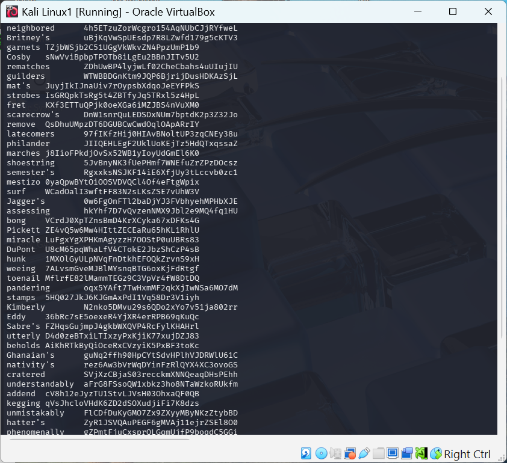
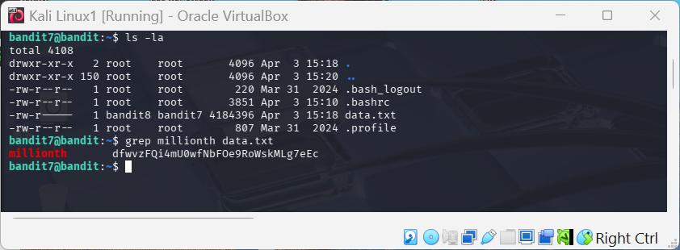

# Level 7 → Level 8

> 🔗 **OverTheWire page:** [Bandit Level 7 → Level 8](https://overthewire.org/wargames/bandit/bandit8.html)

## Topics Covered

- [`grep`](#what-is-grep) → search for text inside files

## Level Goal

The password for the next level is stored in the file `data.txt` next to the word `millionth`.

## Commands You May Need

- `man`
- `grep`
- `sort`
- `uniq`

## Solution

### Step 1

After connecting to the Bandit server using SSH (see the [SSH page](level0.md)), the goal is to read `data.txt`. The password is next to the word `millionth`.

If we try to `cat` the file directly, we have tons of lines.



### Step 2

Checking each line would be impossible. The more efficient way is by using `grep`. To understand `grep` more deeply, see [below](#a-bit-of-theory).

```bash
grep millionth data.txt
```



## A Bit of Theory

```bash
grep millionth data.txt
```

### What Is grep?

grep stands for:

**Global Regular Expression Print**

It is one of the most important and powerful commands in Linux.  
You use it to **search for text** inside files or output.

Think of grep as:

**A super-fast text scanner that finds lines matching a pattern.**

### What Does grep Actually Do?

grep reads:

- one file

- multiple files

- or input coming from another command

And prints **only the lines that contain the text you search for**.

### Basic Syntax

```bash
grep [options] "pattern" filename
```

Examples:

```bash
grep "root" /etc/passwd
grep "password" file.txt
```

### 1. Basic Usage: Search for a word in a file

```bash
grep "hello" file.txt
```

Shows all lines that contain the word **hello**.

### 2. Case-insensitive Search

```bash
grep -i "hello" file.txt
```

Matches:

- hello

- Hello

- HELLO

- hElLo

### 3. Search Inside All Files in a Directory

```bash
grep "keyword" *
```

Search recursively (in ALL subdirectories):

```bash
grep -r "keyword" /path/
```

### 4. Show Line Numbers

```bash
grep -n "keyword" file.txt
```

Output:

3: the keyword is here

### 5. Show Only the Filename (not the line)

Useful when searching through many files:

```bash
grep -l "keyword" *.txt
```

### 6. Count Matches

```bash
grep -c "login" /var/log/auth.log
```

Outputs something like:

12

Means keyword found 12 times.

### 7. Invert Match (show lines that DO NOT contain the keyword)

```bash
grep -v "error" log.txt
```

Shows all lines *except* those containing “error”.

### 8. Use Regular Expressions (Power Mode)

grep supports simple patterns, like:

**Match lines beginning with a word:**

```bash
grep "^root" /etc/passwd
```

**Match lines ending with a word:**

```bash
grep "bash$" /etc/passwd
```

**Match digits:**

```bash
grep "[0-9]" file.txt
```

### Extended regex (grep -E)

```bash
grep -E "error|warning|critical" logfile
```

### 9. Search Only Whole Words

Otherwise “cat” matches “category”.

```bash
grep -w "cat" file.txt
```

### 10. Search Using Pipes

You can connect grep with other commands.

**Example: show all running SSH-related processes**

```bash
ps aux | grep ssh
```

**Example: filter network connections**

```bash
netstat -tulpn | grep LISTEN
```

### Summary (Easy to Remember)

| **Action**          | **Command**            |
|---------------------|------------------------|
| Simple search       | grep "text" file       |
| Ignore case         | grep -i "text" file    |
| Recursive search    | grep -r "text" dir/    |
| Count matches       | grep -c "text" file    |
| Show line numbers   | grep -n "text" file    |
| Show only filenames | grep -l "text" \*      |
| Invert match        | grep -v "text" file    |
| Use regex           | grep -E "pattern" file |
