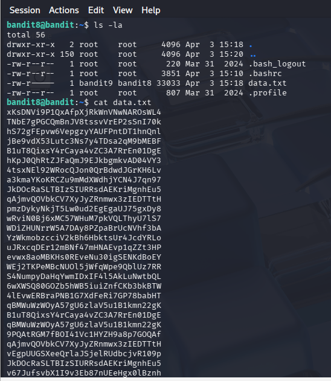
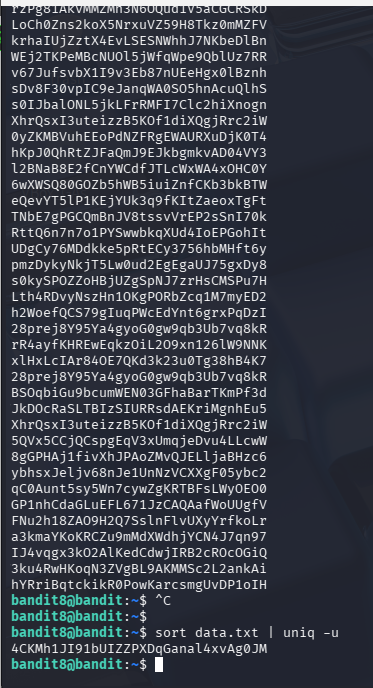

# Level 8 → Level 9

> 🔗 **OverTheWire page:** [Bandit Level 8 → Level 9](https://overthewire.org/wargames/bandit/bandit9.html)

## Topics Covered

- [`sort` and `uniq`](#1-understanding-sort-datatxt) → find the line that appears once
- [Pipe `|`](#-2-understanding-the-pipe-) → send the output of one command to another

## Level Goal

The password for the next level is stored in the file `data.txt` and is the only line of text that occurs only once.

## Commands You May Need

- `man`
- `grep`
- `sort`
- `uniq`

## Important Notes

> Concepts: piping and redirection

## Solution

### Step 1

After connecting to the Bandit server using SSH (see the [SSH page](level0.md)), the call is to read `data.txt` inside the home directory.

If we `cat data.txt`, we will have hundreds of lines, mostly repeated 10 times except the password line.



### Step 2

If we decided to check them one by one, that would be impossible. The more efficient way is to use the `sort` and `uniq` commands. To learn more about `sort`, `uniq` and the pipe operation, see [below](#a-bit-of-theory).

```bash
sort data.txt | uniq -u
```



## A Bit of Theory

### `sort data.txt | uniq -u`

### Step 1: Sort all lines in the file

### Step 2: type only the unique line

### 1. Understanding sort data.txt

sort reads the file and puts the lines in **alphabetical or numerical order**.

**Example** — **file data.txt contains:**

```text
apple
banana
apple
grape
banana
banana
```

Running:

```bash
sort data.txt
```

gives:

```text
apple
apple
banana
banana
banana
grape
```

### Why sort first?

Because uniq *only works on adjacent (next to each other) duplicate lines*.  
So duplicates **must** be next to each other → sorting makes this happen.

### 2. Understanding the pipe |

One of the most interesting concepts in Linux. The pipe takes the **output of the first command** and sends it as the **input of the next**, allowing you to apply multiple tasks at one time.

Visually:

- `sort data.txt` → output goes into → uniq -u

No temporary files needed.

### 3. Understanding uniq -u

uniq means:

Show only **unique lines** by removing duplicates **(but only if they are adjacent).**

`uniq` ignores any nonadjacent lines. The option `-u` means: print only the unique lines, the lines that appear only once.
