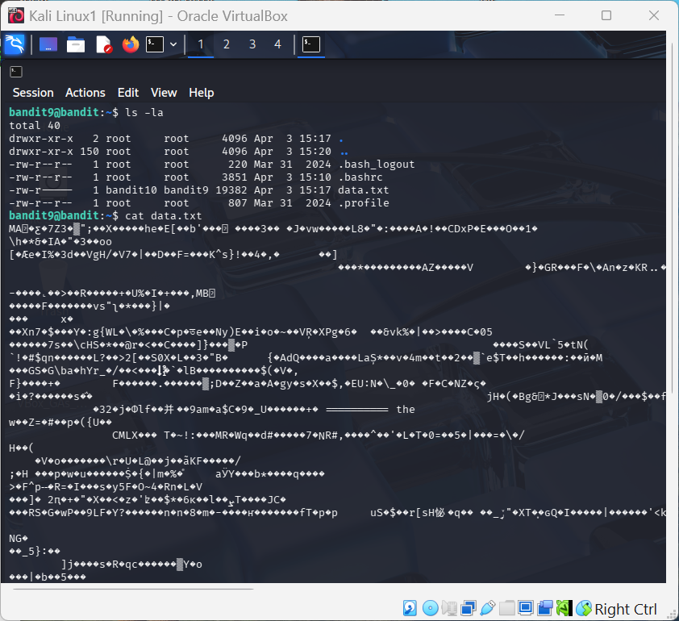
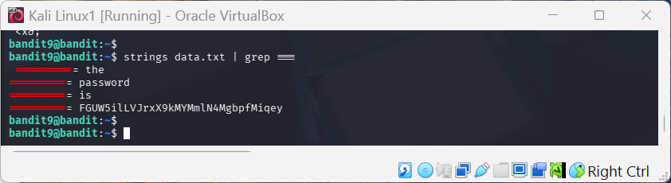

# Level 9 → Level 10

> 🔗 **OverTheWire page:** [Bandit Level 9 → Level 10](https://overthewire.org/wargames/bandit/bandit10.html)

## Topics Covered

- [`strings`](#what-is-strings) → read the human-readable text inside any file

## Level Goal

The password for the next level is stored in the file `data.txt` in one of the few human-readable strings, preceded by several `=` characters.

## Commands You May Need

- `strings`
- `grep`

## Solution

### Step 1

After connecting to the Bandit server using SSH (see the [SSH page](level0.md)), the call is to read `data.txt` inside the home directory, as the password is next to `===`.

If we `cat data.txt`, we will have some garbage with a few human-readable lines.



### Step 2

If we decided to read everything, that would be tedious. The more efficient way is to use the `strings` command. We use `strings` to catch the human-readable content inside the file. It's a widely used command in cybersecurity, mastering it would be a very powerful skill.

```bash
strings data.txt | grep ====
```



## A Bit of Theory

### What is `strings`?

`strings` prints the sequences of human-readable characters found inside a file, even if the file is binary.

```bash
strings data.txt
```

### Why is it useful?

Binary files (programs, images, data files) are full of unreadable bytes, but they often contain readable text such as messages, file names or passwords. `strings` skips the unreadable parts and shows only the text.

### Useful option

- `-n <number>` → show only the strings that are at least that many characters long (the default is 4)

### Using `strings` with `grep`

Even then, the output can still be long, so we pipe it to `grep` to keep only the lines we need:

```bash
strings data.txt | grep ====
```
